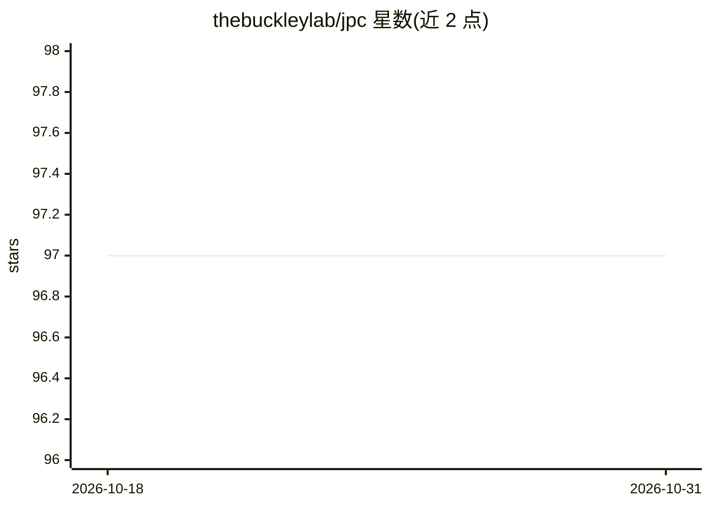

# thebuckleylab/jpc

⭐ 97 · Python · MIT · 推送 2026-10-21 · [GitHub](https://github.com/thebuckleylab/jpc) · [官网](https://thebuckleylab.github.io/jpc/) · 组织维护

**JAX 预测编码（PC）神经网络训练库，供研究者使用**

JPC 是基于 JAX 的预测编码网络（PCN）训练库，支持判别式、生成式与混合模型，核心代码少于 1000 行，采用函数式设计。提供多种离散与连续优化器求解 PC 推理动力学，包括基于 diffrax 的 ODE 求解器，并通过 jpc.make_pc_step() 一键完成推理积分与参数更新（已 jitted），另提供分析工具与研究 PCN 的扩展接口。要求 Python 3.10+、JAX 0.4.38–0.5.2，GPU 需升级 CUDA 版 JAX。配套论文与文档网站。

## 筛选速览

| 维度 | 判定 | 备注 |
|---|---|---|
| AI 角色 | `ai-native` | 本体是模型或模型工具 |
| 许可风险 | `permissive` | MIT |
| 部署形态 | `library` | 以包/库形式分发 |
| 模型依赖 | — | README 未给出锁定关系 |
| 硬件要求 | — | 无带数字的原话,不猜 |
| 安装摩擦 | `medium` | 含编译或系统依赖之一 |
| 成熟度 | — | 结构信号不足 |

## 能力要点

- 支持判别式、生成式与混合预测编码模型训练
- 多种推理动力学优化器，含 ODE 求解器（diffrax）
- 核心库代码 <1000 行，函数式设计，训练函数已 jitted
- 提供 PCN 分析工具与自定义训练步骤接口

## 适用场景

- 用预测编码算法训练判别式或生成式神经网络
- 研究 PCN 的推理动力学与无限宽度/深度等理论性质
- 与 Equinox 模型结合做 PC 局部学习实验

## 场景标签

`科研工具` · 领域:学习与行业

## 证据(README 行号)

> L16: JPC is a **J**AX library for training neural
> L20: training of a variety of PCNs including discriminative, generative and hybrid
> L64: 1. integrates the inference (activity) dynamics using a diffrax ODE solver, and

## 星数曲线

2026-10-18 97 → 2026-10-31 97（+0）

---
*卡片 v1 · prompt 1.4 · 生成 2026-10-23 · 置信度 mid · 依据 README sha `1359c23c24e4` · [字段定义](../../DATASET.md)*
