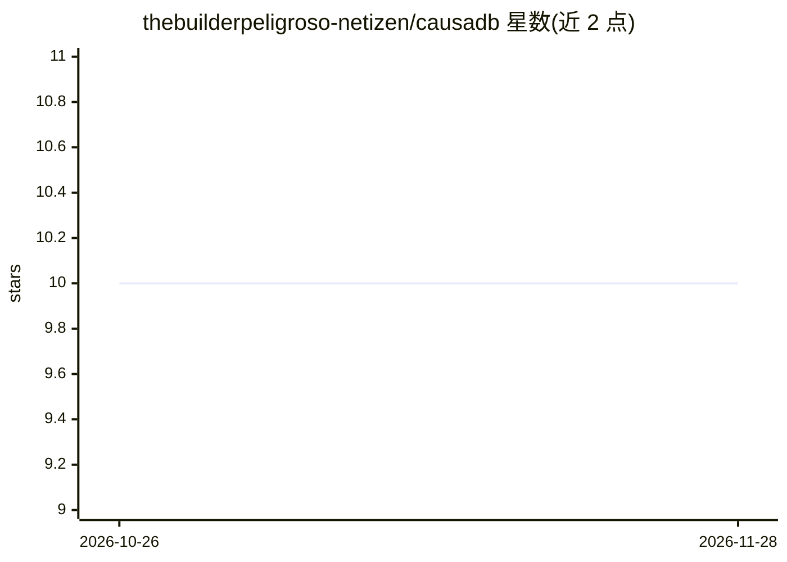

# thebuilderpeligroso-netizen/causadb

⭐ 10 · Python · MIT · 推送 2026-09-29 · [GitHub](https://github.com/thebuilderpeligroso-netizen/causadb) · [官网](https://causadb.netlify.app/) · 个人维护 · 中文 README

**为 AI 代理提供项目级持久记忆，切换代理不丢上下文**

CausaDB 是面向 AI 代理的项目记忆工具：以本地、追加式、哈希链保护的因果账本记录文件变更、命令、决策与证据，会话结束后可通过 revive 重建状态与上下文摘要，并可核验代理声称完成的工作。提供 trace/why/impact、bisect、snapshot、score、audit 等命令，通过 MCP server（21 工具 + 4 资源）接入 OpenCode、Claude、Codex、Cursor 等代理，也支持以 skill 文件方式接入无 MCP 的代理，并支持多代理协作注释。Python 3.10+，状态为 pre-release。

## 筛选速览

| 维度 | 判定 | 备注 |
|---|---|---|
| AI 角色 | `ai-ecosystem` | LLM/agent 周边工具 |
| 许可风险 | `permissive` | MIT |
| 部署形态 | `library` | 以包/库形式分发 |
| 模型依赖 | — | README 未给出锁定关系 |
| 硬件要求 | — | 无带数字的原话,不猜 |
| 安装摩擦 | `low` | 无编译、无系统依赖或容器化 |
| 成熟度 | `idea` | |

## 能力要点

- 本地追加式因果账本（哈希链），记录效果、决策与证据
- revive 命令重建项目状态与上下文摘要，支持核验代理声明
- MCP server 暴露 21 工具 + 4 资源，可经 HTTP 供远程代理只读访问
- 多代理协作：AUDIT_REPORT / ACTION_PLAN 共享注释文件

## 适用场景

- 会话中断后让新代理重建项目上下文继续工作
- 核验代理声称完成的任务是否与记录一致
- 定位引入 bug 的具体事件（bisect）
- 多个代理共用同一份项目历史并分工协作

## 场景标签

`Agent 记忆` · 领域:Agent 开发

## 证据(README 行号)

> L35: CausaDB records the operational history of your project into **local, persistent, reconstructible memory**. It does
> L162: CausaDB exposes an **MCP server with 21 tools + 4 resources** (including `recover` to reconstruct a session's full

## 星数曲线

2026-10-26 10 → 2026-11-28 10（+0）

---
*卡片 v1 · prompt 1.4 · 生成 2026-11-19 · 置信度 high · 依据 README sha `842d4d6136fa` · [字段定义](../../DATASET.md)*
