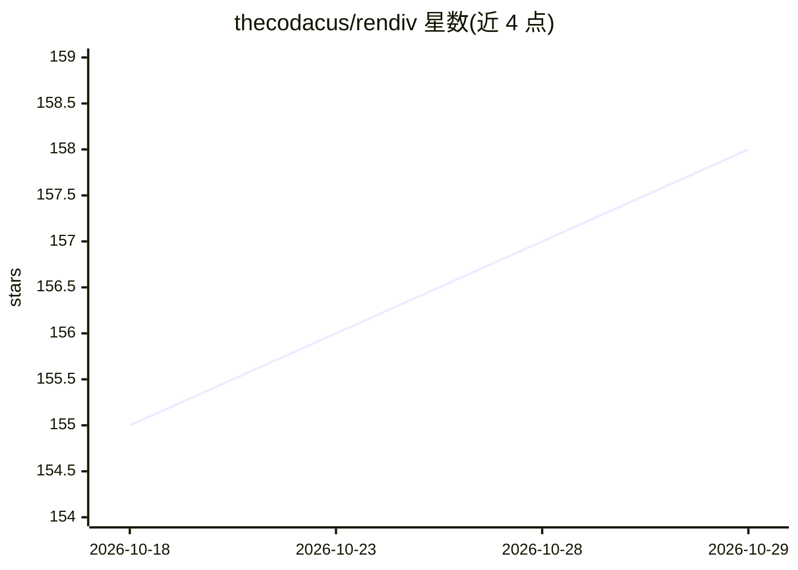

# thecodacus/rendiv

⭐ 158 · TypeScript · Apache-2.0 · 推送 2026-09-28 · [GitHub](https://github.com/thecodacus/rendiv) · [官网](https://thecodacus.github.io/rendiv/) · 个人维护

**面向 AI agent 的代码式视频创作框架：React+TS 写视频**

代码优先的视频创作与渲染框架：视频定义为纯 React 组件（给定帧号渲染一帧），可版本化、可参数化。设计目标是让 LLM 与 AI agent 通过编写 React 代码生成视频——提供 agent skills（支持 Claude Code、Cursor、Codex 等安装）、Studio 内置 agent 终端。渲染管线为 Playwright 无头 Chromium 并行截图 + FFmpeg 合成，输出 MP4/WebM/GIF 等。要求 Node.js 18+，提供 npm 安装、Docker 镜像与嵌入播放器；许可证 Apache 2.0（README 与 Remotion 做许可差异对比）。

## 筛选速览

| 维度 | 判定 | 备注 |
|---|---|---|
| AI 角色 | `ai-ecosystem` | LLM/agent 周边工具 |
| 许可风险 | `permissive` | Apache-2.0 |
| 部署形态 | `self-host` | docker 或自建部署 |
| 模型依赖 | — | README 未给出锁定关系 |
| 硬件要求 | — | 无带数字的原话,不猜 |
| 安装摩擦 | `low` | 无编译、无系统依赖或容器化 |
| 成熟度 | — | 结构信号不足 |

## 能力要点

- 视频即 React 组件，确定性、可 git 版本化、可参数化
- agent skills 让 AI 编码 agent 学会 Rendiv API（npx skills add）
- Playwright 并行截图 + FFmpeg 合成，支持 MP4/WebM/GIF/MP3/PNG 序列输出
- Studio 含交互时间线、渲染队列与可启动 CLI agent 的集成终端

## 适用场景

- 让 AI agent 根据自然语言描述生成并迭代视频
- 用 React+TypeScript 参数化批量生产动态图形视频
- 在浏览器 Studio 中帧级预览、时间线编辑后渲染成片

## 场景标签

`视频生成` · 领域:内容生成

## 证据(README 行号)

> L10: Create videos programmatically with **React and TypeScript** — designed from the ground up for AI agents, LLM pipel
> L26: Building with an AI coding agent? Install the rendiv agent skill so your agent knows the API:
> L187: **The workflow**: Describe what you want in natural language. An AI agent writes the Rendiv composition. `rendiv r

## 星数曲线

2026-10-18 155 → 2026-10-29 158（+3）

---
*卡片 v1 · prompt 1.4 · 生成 2026-10-22 · 置信度 high · 依据 README sha `3e3d9dda57a9` · [字段定义](../../DATASET.md)*
