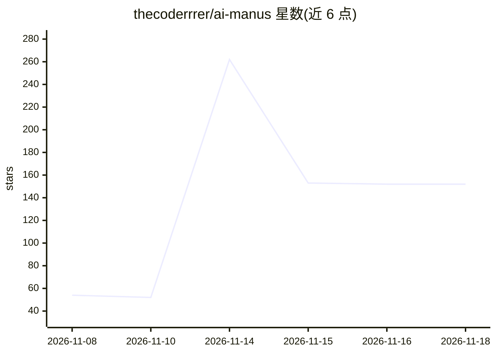

# thecoderrrer/ai-manus

⭐ 152 · Python · Apache-2.0 · 推送 2026-11-07 · [GitHub](https://github.com/thecoderrrer/ai-manus) · 个人维护

**面向日常任务的自主 AI Agent：自动执行代码与浏览器操作**

自称 Manus 的自主 AI Agent 系统，宣称可在沙箱环境中运行多种工具与操作：自主编写并执行代码、控制浏览器（导航页面、填写表单、采集信息）、执行多步骤任务，供学习、家庭与轻量办公场景的非开发者使用。README 描述了配置与试运行流程，并给出最低/推荐硬件兼容表。但可见内容未提供任何具体安装命令、API 接入方式或代码仓库结构，仅含功能宣传文案与搜索关键词列表。

## 筛选速览

| 维度 | 判定 | 备注 |
|---|---|---|
| AI 角色 | `ai-native` | 本体是模型或模型工具 |
| 许可风险 | `permissive` | Apache-2.0 |
| 部署形态 | `None` |  |
| 模型依赖 | — | README 未给出锁定关系 |
| 硬件要求 | — | 无带数字的原话,不猜 |
| 安装摩擦 | `low` | 无编译、无系统依赖或容器化 |
| 成熟度 | — | 结构信号不足 |

## 能力要点

- 自主编写并执行代码完成多步任务（L10）
- 浏览器控制：导航网页、填写表单、采集信息（L11）
- 面向家庭、学习与轻量工作的个人助手定位（L22）

## 适用场景

- 让学生整理研究笔记并运行小脚本
- 让 Agent 代替人工在多个网页间采集信息
- 把重复的小型日常任务委派给后台 Agent

## 场景标签

`AI 助手` `编码 Agent` `浏览器自动化` · 领域:效率与自动化

## 证据(README 行号)

> L10: - **Autonomous Code Execution:** Manus AI agent runs code on its own to complete tasks, so you can focus on decisio
> L18: Manus is an autonomous AI agent designed to run code and control a browser on your behalf. Instead of acting like a

## 星数曲线

2026-11-08 54 → 2026-11-18 152（+98）

---
*卡片 v1 · prompt 1.4 · 生成 2026-11-17 · 置信度 mid · 依据 README sha `08b2ce697fe2` · [字段定义](../../DATASET.md)*
