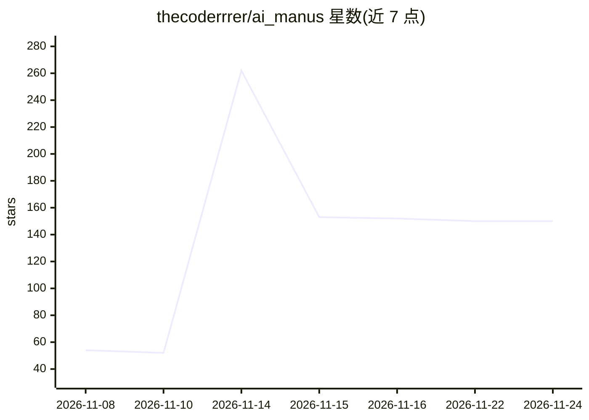

# thecoderrrer/ai_manus

⭐ 148 · Apache-2.0 · 推送 2026-11-07 · [GitHub](https://github.com/thecoderrrer/ai_manus) · 个人维护

**面向日常任务的自主 AI Agent：自动执行代码与浏览器操作**

自称 Manus 的自主 AI Agent 系统，在沙箱环境中运行各类工具与操作：自主编写并执行脚本、控制浏览器完成网页导航、表单填写与信息收集，可串联多步骤任务，定位为家庭、学习与轻量办公场景的后台个人助手。README 描述兼容性要求（64 位系统、双核 CPU、4 GB 内存起）并给出配置与使用步骤，但未提供具体的安装命令、模型接入方式或代码入口，仅含下载提示与促销码，技术细节有限。

## 筛选速览

| 维度 | 判定 | 备注 |
|---|---|---|
| AI 角色 | `ai-native` | 本体是模型或模型工具 |
| 许可风险 | `permissive` | Apache-2.0 |
| 部署形态 | `None` |  |
| 模型依赖 | — | README 未给出锁定关系 |
| 硬件要求 | — | 无带数字的原话,不猜 |
| 安装摩擦 | `low` | 无编译、无系统依赖或容器化 |
| 成熟度 | — | 结构信号不足 |

## 能力要点

- 自主编写并执行代码完成任务的 Agent
- 浏览器控制：导航网页、填写表单、收集信息
- 代码与浏览器操作可在同一任务流中衔接
- 面向学习、家庭与轻量办公的小规模任务场景

## 适用场景

- 让代理代为执行重复性的脚本与网页操作
- 收集多网页信息并整理为摘要
- 组织研究笔记与运行小型计算任务

## 场景标签

`AI 助手` `浏览器自动化` · 领域:效率与自动化

## 证据(README 行号)

> L10: - **Autonomous Code Execution:** Manus AI agent runs code on its own to complete tasks, so you can focus on decisio
> L18: Manus is an autonomous AI agent designed to run code and control a browser on your behalf. Instead of acting like a

## 星数曲线

2026-11-08 54 → 2026-11-24 150（+96）

---
*卡片 v1 · prompt 1.4 · 生成 2026-11-17 · 置信度 low · 依据 README sha `08b2ce697fe2` · [字段定义](../../DATASET.md)*
