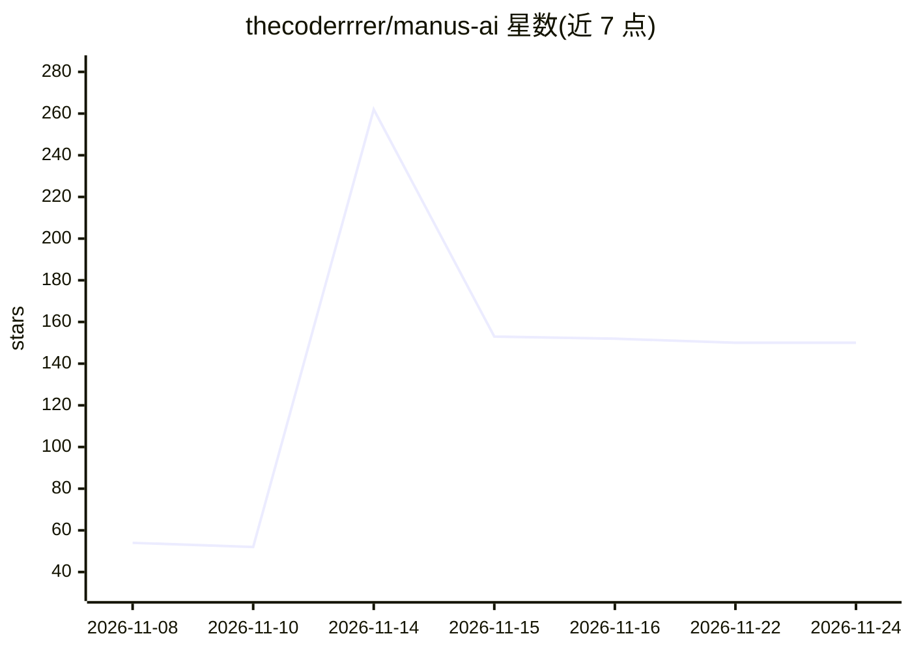

# thecoderrrer/manus-ai

⭐ 148 · Python · Apache-2.0 · 推送 2026-11-07 · [GitHub](https://github.com/thecoderrrer/manus-ai) · 个人维护

**面向个人用户的自主 AI 代理：代为执行代码与浏览器操作**

Manus 定位为自主 AI 代理，代表用户编写并执行脚本、控制浏览器（导航网页、填写表单、采集信息），并可执行多步骤任务。目标用户为学生、远程工作者与轻量办公人群，用于研究整理、日常事务自动化与轻量开发测试。README 提供系统兼容性表（最低双核 CPU、4 GB 内存）与使用流程说明（配置、测试、调整自动化触发），但未提供安装命令、代码入口或技术实现细节，也未见下载链接以外的获取途径。

## 筛选速览

| 维度 | 判定 | 备注 |
|---|---|---|
| AI 角色 | `ai-native` | 本体是模型或模型工具 |
| 许可风险 | `permissive` | Apache-2.0 |
| 部署形态 | `None` |  |
| 模型依赖 | — | README 未给出锁定关系 |
| 硬件要求 | — | 无带数字的原话,不猜 |
| 安装摩擦 | `low` | 无编译、无系统依赖或容器化 |
| 成熟度 | — | 结构信号不足 |

## 能力要点

- 自主编写并执行代码完成任务
- 浏览器控制：导航网页、填表、采集信息
- 代码与浏览器动作可在同一任务流中衔接
- 支持跨会话记住并复用工作流模式

## 适用场景

- 让学生整理研究资料、跑小脚本
- 让代理代为浏览多个网页并汇总信息
- 远程办公中自动化重复性小任务

## 场景标签

`浏览器自动化` `编码 Agent` · 领域:效率与自动化

## 证据(README 行号)

> L10: - **Autonomous Code Execution:** Manus AI agent runs code on its own to complete tasks, so you can focus on decisio
> L18: Manus is an autonomous AI agent designed to run code and control a browser on your behalf. Instead of acting like a

## 星数曲线

2026-11-08 54 → 2026-11-24 150（+96）

---
*卡片 v1 · prompt 1.4 · 生成 2026-11-17 · 置信度 mid · 依据 README sha `08b2ce697fe2` · [字段定义](../../DATASET.md)*
