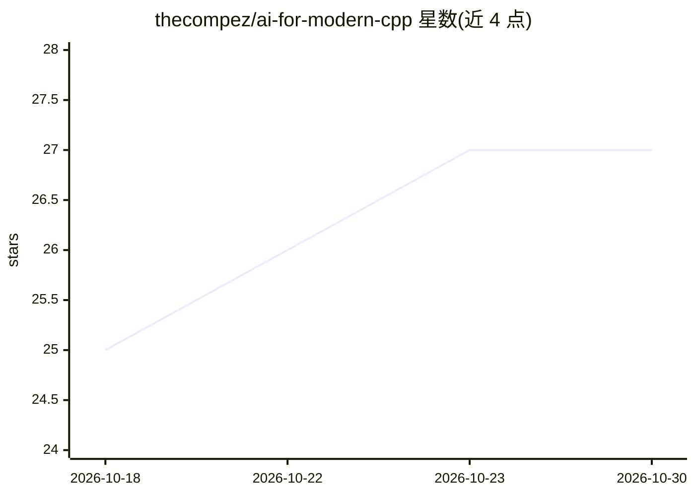

# thecompez/ai-for-modern-cpp

⭐ 27 · CMake · NOASSERTION · 推送 2026-10-27 · [GitHub](https://github.com/thecompez/ai-for-modern-cpp) · 个人维护

**教 AI 编码代理写安全现代 C++20/23/26 的可执行知识库**

面向 AI coding agent 的现代 C++ 工程知识库模板仓库，组合五种知识形式：AGENTS.md 规则、任务路由指南、标注对错的模式示例、必须可构建的 C++26 模块化源码证明，以及测试 agent 是否遵循规则的评测场景。知识覆盖模块、concepts、std::expected、基于目标的 CMake/Ninja 构建、Qt Quick/QML 界面工作流与规则驱动评审（稳定标识符引用）。提供 Claude Code/Codex 入口与通用 prompt，附 Linux GCC 15 验证脚本；定位是规范知识载体而非应用产品。

## 筛选速览

| 维度 | 判定 | 备注 |
|---|---|---|
| AI 角色 | `ai-knowledge` | 知识聚合/清单类 |
| 许可风险 | `none` | NOASSERTION |
| 部署形态 | `None` |  |
| 模型依赖 | — | README 未给出锁定关系 |
| 硬件要求 | — | 无带数字的原话,不猜 |
| 安装摩擦 | `medium` | 含编译或系统依赖之一 |
| 成熟度 | — | 结构信号不足 |

## 能力要点

- 规则/路由/模式/可构建源码/评测五层知识架构
- C++26 模块化参考实现，含 std::expected、concepts、ranges 等示例
- Qt Quick/QML 界面工作流与严格 qmllint/运行时验证要求
- V0–V4 自适应验证等级与规则标识符驱动的评审契约

## 适用场景

- 让 Claude Code、Codex 等 agent 遵循规范修改现代 C++ 仓库
- 以可构建源码作为工程规则的执行性证明
- 评估 AI agent 是否按规则执行 C++ 工程任务

## 场景标签

`模型评测` `提示工程` · 领域:Agent 开发

## 证据(README 行号)

> L3: An executable knowledge base that teaches AI coding agents how to understand,
> L8: This repository combines five forms of knowledge:
> L14: 5. **Evals** — scenarios that test whether an AI agent applies the rules.

## 星数曲线

2026-10-18 25 → 2026-10-30 27（+2）

---
*卡片 v1 · prompt 1.4 · 生成 2026-10-26 · 置信度 high · 依据 README sha `521c81354414` · [字段定义](../../DATASET.md)*
