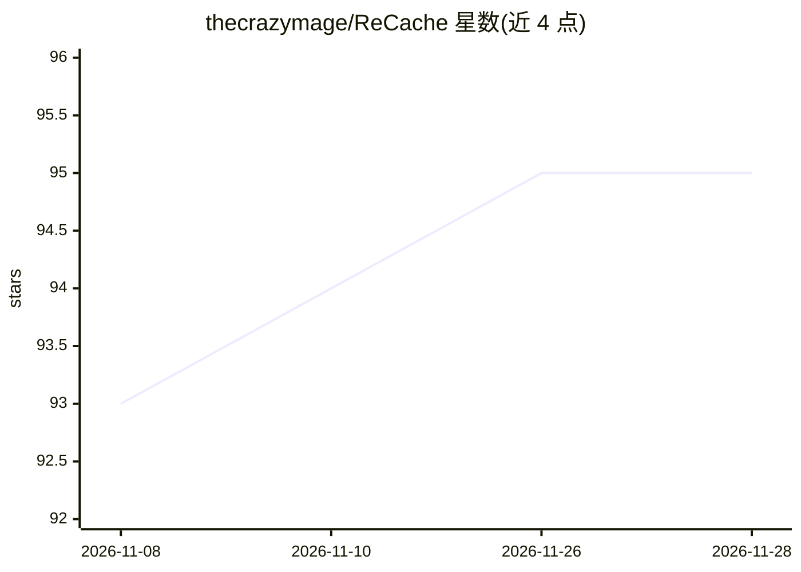

# thecrazymage/ReCache

⭐ 95 · Python · Apache-2.0 · 推送 2026-11-09 · [GitHub](https://github.com/thecrazymage/ReCache) · [官网](https://arxiv.org/abs/2606.06060) · 组织维护

**科研者用：REINFORCE 学习扩散模型缓存调度策略以加速推理**

面向扩散模型推理加速的研究代码：通过策略梯度方法（REINFORCE）训练预算条件化的时间步调度策略，在固定全量计算预算下选择哪些去噪步完整重算，兼顾与未缓存输出的保真度与生成质量奖励。训练无需标注数据、无需通过完整去噪轨迹反传。支持 FLUX.1-dev、Wan2.1 1.3B、HunyuanVideo 三种模型与 FORA、Δ-DiT、DiCache、LeMiCa、TaylorSeer、HiCache、Taylor-DP 七种缓存方法，单一训练策略可跨预算推理。提供 conda 环境安装、参考数据集生成、训练与 VBench 评估流程，以及论文中学习到的策略表。PyTorch 基于 CUDA 12.8，Wan 测试集约需 100 GB RAM。

## 筛选速览

| 维度 | 判定 | 备注 |
|---|---|---|
| AI 角色 | `ai-ecosystem` | LLM/agent 周边工具 |
| 许可风险 | `permissive` | Apache-2.0 |
| 部署形态 | `None` |  |
| 模型依赖 | — | README 未给出锁定关系 |
| 硬件要求 | — | 无带数字的原话,不猜 |
| 安装摩擦 | `medium` | 含编译或系统依赖之一 |
| 成熟度 | — | 结构信号不足 |

## 能力要点

- 策略梯度训练预算条件化时间步调度策略，无需标注数据与全轨迹反传
- 支持 7 种缓存方法（FORA/Δ-DiT/DiCache/LeMiCa/TaylorSeer/HiCache/Taylor-DP）
- 单一训练策略可跨不同计算预算推理，无需重训
- 附论文报告的学习到策略（时间步索引表），可直接用于评估

## 适用场景

- 为 FLUX/Wan/HunyuanVideo 等扩散模型选择缓存调度以加速推理
- 复现论文中缓存策略的训练与 VBench 评估
- 在不重训的情况下跨预算切换推理加速档位

## 场景标签

`科研工具` `推理引擎` · 领域:学习与行业

## 证据(README 行号)

> L21: In this work, we align caching schedule selection with the goals of inference: preserving fidelity to uncached outp
> L117: ReCache trains a budget-conditioned timestep policy. It is trained for one model and one caching method, and each 

## 星数曲线

2026-11-08 93 → 2026-11-28 95（+2）

---
*卡片 v1 · prompt 1.4 · 生成 2026-11-18 · 置信度 high · 依据 README sha `816a45a6023d` · [字段定义](../../DATASET.md)*
