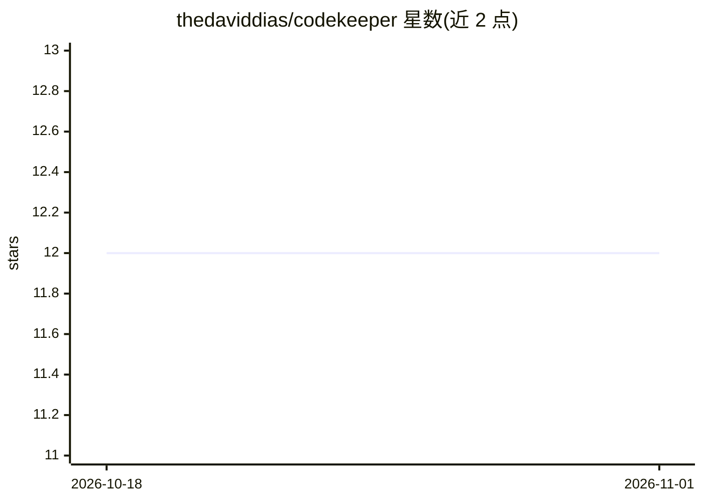

# thedaviddias/codekeeper

⭐ 12 · JavaScript · NOASSERTION · 推送 2026-01-29 · [GitHub](https://github.com/thedaviddias/codekeeper) · 个人维护

**防止 AI 编码助手破坏 React/Next.js 代码的校验脚本集**

面向 React/Next.js 项目的校验脚本与 ESLint 插件集合，拦截 AI 助手常见的代码问题：as any 等不安全类型断言、barrel 文件、超大文件、缺失 JSDoc、混乱目录结构与深层相对导入。提供独立脚本（check-*.js）与 ESLint 规则，通过 Lefthook/Husky/pre-commit 等 Git 钩子在提交时校验，并给出 GitHub Actions/GitLab CI/Jenkins 等 CI 配置示例。问题输出可交给 LLM（如 Claude、ChatGPT）修复。要求 Node.js 18+ 与 npm 8+，安装方式为复制脚本文件到项目中。

## 筛选速览

| 维度 | 判定 | 备注 |
|---|---|---|
| AI 角色 | `ai-ecosystem` | LLM/agent 周边工具 |
| 许可风险 | `permissive` | NOASSERTION |
| 部署形态 | `library` | 以包/库形式分发 |
| 模型依赖 | — | README 未给出锁定关系 |
| 硬件要求 | — | 无带数字的原话,不猜 |
| 安装摩擦 | `low` | 无编译、无系统依赖或容器化 |
| 成熟度 | — | 结构信号不足 |

## 能力要点

- 6 个独立校验脚本覆盖类型安全、导入质量、复杂度、文档、目录结构与导入路径
- ESLint 插件规则（no-unsafe-as-casts、no-barrel-files 等）
- 兼容 Lefthook/Husky/pre-commit/GitHub Actions/GitLab CI/Jenkins/Vercel/Netlify
- 可通过 NODE_ENV=development 临时跳过检查，脚本内常量可自定义限制

## 适用场景

- 在团队项目中拦截 AI 生成的不安全类型断言与坏结构代码
- 提交时自动校验代码质量，把问题交给 AI 助手修复
- 在 CI 流水线中统一执行 CodeKeeper 校验规则

## 场景标签

`代码审查` · 领域:编码与开发

## 证据(README 行号)

> L14: **CodeKeeper** is a battle-tested (yes, I'm using it in production) collection of validation scripts that prevent A
> L30: CodeKeeper provides pre-built validation scripts that catch these issues before they hit production:
> L127: 3. **🤖 AI-assisted fixes** - Use LLMs (like Claude, ChatGPT) to fix the issues CodeKeeper found

## 星数曲线

2026-10-18 12 → 2026-11-01 12（+0）

---
*卡片 v1 · prompt 1.4 · 生成 2026-10-31 · 置信度 mid · 依据 README sha `a62e7a244888` · [字段定义](../../DATASET.md)*
