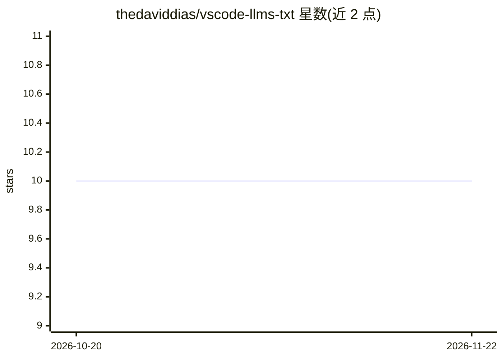

# thedaviddias/vscode-llms-txt

⭐ 10 · TypeScript · NOASSERTION · 推送 2026-02-11 · [GitHub](https://github.com/thedaviddias/vscode-llms-txt) · [官网](https://marketplace.visualstudio.com/items?itemName=TheDavidDias.vscode-llms-txt) · 个人维护

**VS Code 扩展：浏览、搜索与管理网站的 LLMS.txt 文件**

一款 VS Code 扩展，用于浏览、搜索和管理来自各网站的 LLMS.txt 文件，可在编辑器内直接查看文件内容。功能包括分类浏览网站列表、模糊匹配搜索与历史记录、按类别过滤、收藏管理、一键复制 LLMS.txt / LLMS Full.txt URL、内容预览与列表自动刷新，并支持通过 VS Code 设置自定义刷新间隔等选项。数据来源为 LLMS.txt Hub。面向使用 VS Code 的开发者，帮助了解网站如何通过 LLMS.txt 与 AI 语言模型交互。安装走 VS Code 扩展市场，开发需 Node.js v14+ 与 npm v6+。

## 筛选速览

| 维度 | 判定 | 备注 |
|---|---|---|
| AI 角色 | `ai-ecosystem` | LLM/agent 周边工具 |
| 许可风险 | `none` | NOASSERTION |
| 部署形态 | `library` | 以包/库形式分发 |
| 模型依赖 | — | README 未给出锁定关系 |
| 硬件要求 | — | 无带数字的原话,不猜 |
| 安装摩擦 | `low` | 无编译、无系统依赖或容器化 |
| 成熟度 | — | 结构信号不足 |

## 能力要点

- 分类浏览提供 LLMS.txt 的网站列表并支持自动刷新
- 模糊匹配搜索、搜索历史与按类别过滤
- 在编辑器内直接预览文件内容，一键复制 LLMS.txt / LLMS Full.txt URL
- 通过 VS Code 设置自定义刷新间隔、搜索历史上限等

## 适用场景

- 在编辑器内查找某网站是否提供 LLMS.txt 文件
- 按类别整理并收藏常用的 LLMS.txt 站点
- 复制 LLMS.txt URL 以供调试或文档工作流使用

## 场景标签

 · 领域:开发者工具/编辑器插件

## 证据(README 行号)

> L11: A VS Code extension that simplifies browsing, searching, and managing LLMS.txt files from various websites. Access 
> L24: - **🌐 Browse Websites**: View a categorized list of websites that provide LLMS.txt files

## 星数曲线

2026-10-20 10 → 2026-11-22 10（+0）

---
*卡片 v1 · prompt 1.4 · 生成 2026-11-19 · 置信度 high · 依据 README sha `830f76c9c610` · [字段定义](../../DATASET.md)*
