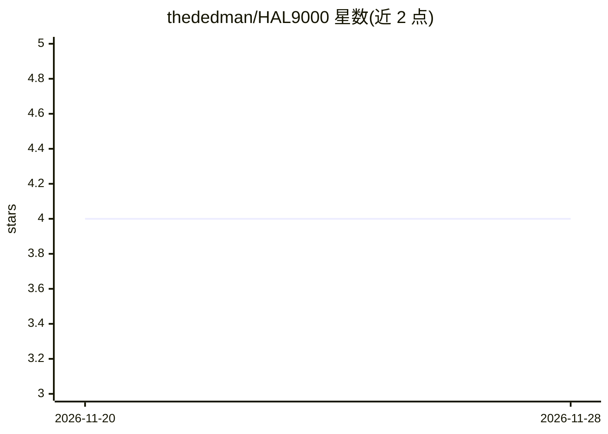

# thededman/HAL9000

⭐ 4 · C++ · MIT · 推送 2026-11-19 · [GitHub](https://github.com/thededman/HAL9000) · 个人维护

**让 M5Stack 小设备扮演 HAL 9000 对话的桌面伴侣固件**

围绕 M5Stack 设备族的 HAL 9000 桌面伴侣项目：CoreS3 桌面主机与 Cardputer Zero 等最多五个 HAL 通过 Wi-Fi 互相对话，每台有自己的性格与台词。AI 大脑是电脑上的本地程序，用 Ollama 运行的模型生成台词，Piper 合成语音，whisper.cpp 识别语音；也可改用 Claude/ChatGPT API（需自备 key）。桌面主机可脱离电脑独立运行预录台词。固件用 PlatformIO 构建，安装指引在 docs/SETUP.md，已在 macOS 测试。

## 筛选速览

| 维度 | 判定 | 备注 |
|---|---|---|
| AI 角色 | `ai-native` | 本体是模型或模型工具 |
| 许可风险 | `permissive` | MIT |
| 部署形态 | `None` |  |
| 模型依赖 | local-ok | 支持本地模型 |
| 硬件要求 | — | 无带数字的原话,不猜 |
| 安装摩擦 | `low` | 无编译、无系统依赖或容器化 |
| 成熟度 | — | 结构信号不足 |

## 能力要点

- 五台 M5Stack 设备各自扮演一个有性格的 HAL，经 Wi-Fi 协作对话
- 本地 AI 大脑：Ollama 生成台词、Piper 语音合成、whisper.cpp 语音识别
- 支持键盘输入、按键说话与「Hey HAL」唤醒词
- 提供模拟器，可在无硬件时于电脑窗口中运行 HAL Zero

## 适用场景

- 在桌面上摆一台会打招呼、报怨和回答问题的 HAL 9000
- 让两台设备就任意话题现场互相辩论
- 完全离线的本地语音对话，数据不出家门

## 场景标签

`语音 Agent` `语音合成` `语音识别` · 领域:对话与助手

## 证据(README 行号)

> L18: - **Nothing is scripted and nothing leaves your home.** An AI model on your own computer
> L72: - **The brain is optional, and local.** A small program on your computer writes each line
> L193: computer does the thinking with an AI model that runs locally (Ollama),

## 星数曲线

2026-11-20 4 → 2026-11-28 4（+0）

---
*卡片 v1 · prompt 1.4 · 生成 2026-11-21 · 置信度 high · 依据 README sha `9a52c0fd7183` · [字段定义](../../DATASET.md)*
