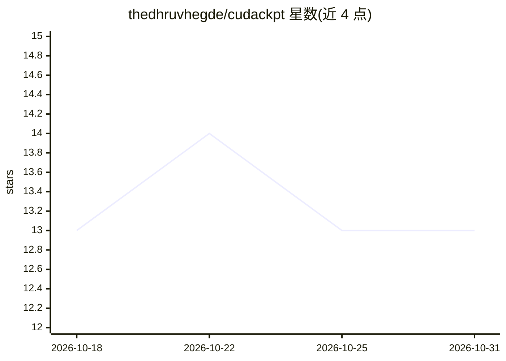

# thedhruvhegde/cudackpt

⭐ 13 · Go · NOASSERTION · 推送 2026-07-09 · [GitHub](https://github.com/thedhruvhegde/cudackpt) · [官网](https://github.com/DDVHegde100/cudackpt#readme) · 个人维护

**Linux 上单 GPU CUDA 进程的检查点与恢复工具**

通过 LD_PRELOAD shim 拦截 CUDA Driver API，将设备内存、流、模块状态与 CRIU 捕获的进程状态快照为带版本号的磁盘镜像，恢复时由 CRIU 恢复进程、按原虚拟地址重映射 GPU 内存后继续执行。面向 HPC/机器学习工作负载的运维开发者，提供 CLI 与 systemd 单元，支持回滚、镜像保留 GC、Prometheus 指标。限制：仅单 GPU，多 GPU/MIG/NCCL/CUDA graphs 被拒绝；自述早期版本（v0.3.0），生产使用前需自行验证；闭源专有许可。

## 筛选速览

| 维度 | 判定 | 备注 |
|---|---|---|
| AI 角色 | `ai-ecosystem` | LLM/agent 周边工具 |
| 许可风险 | `none` | NOASSERTION |
| 部署形态 | `None` |  |
| 模型依赖 | — | README 未给出锁定关系 |
| 硬件要求 | — | 无带数字的原话,不猜 |
| 安装摩擦 | `high` | 编译与系统依赖俱全 |
| 成熟度 | `idea` | |

## 能力要点

- LD_PRELOAD 拦截 CUDA Driver API，无需修改应用源码
- GPU 内存 + CRIU 进程状态的全栈检查点与版本化镜像（CRC32C、增量快照）
- 提供回滚、镜像保留 GC、restore 事件日志与 Prometheus 指标
- 细粒度 RPC 控制：freeze/snapshot/gpu-restore/resume

## 适用场景

- 长时间运行的 CUDA 训练/计算任务做检查点以便故障后恢复
- GPU 进程快照回滚与镜像留存管理
- 运维侧通过 CLI/systemd 集成 GPU 进程生命周期管理

## 场景标签

`MLOps` · 领域:训练与推理

## 证据(README 行号)

> L8: **Checkpoint and restore single-GPU CUDA processes on Linux** — without modifying your application.
> L10: cudackpt intercepts the CUDA Driver API through an `LD_PRELOAD` shim, snapshots device memory and stream state, coo
> L17: - **Full-stack checkpoint** — GPU allocations, streams, modules, and process state via CRIU

## 星数曲线

2026-10-18 13 → 2026-10-31 13（+0）

---
*卡片 v1 · prompt 1.4 · 生成 2026-10-31 · 置信度 high · 依据 README sha `64ec5494fc2b` · [字段定义](../../DATASET.md)*
