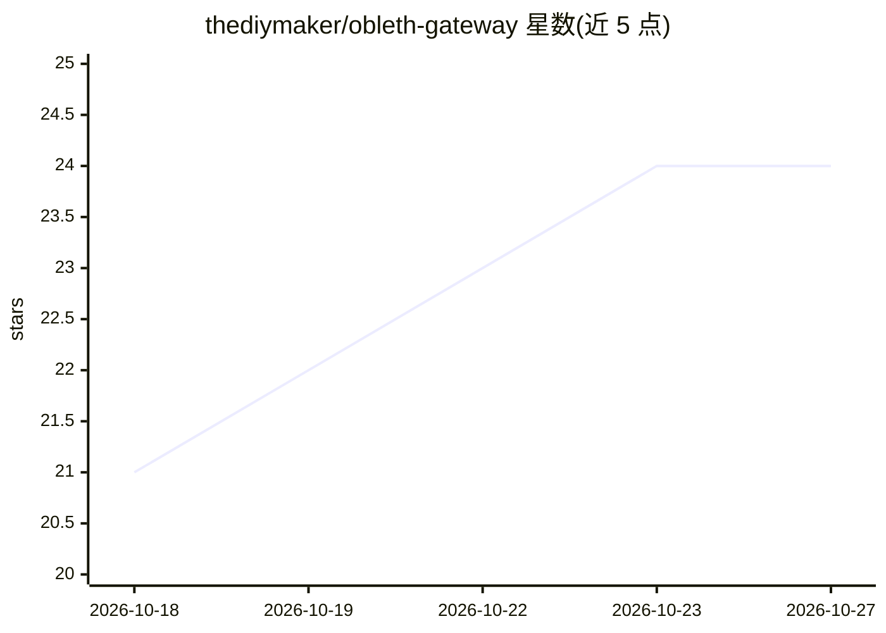

# thediymaker/obleth-gateway

⭐ 24 · Rust · NOASSERTION · 推送 2026-10-26 · [GitHub](https://github.com/thediymaker/obleth-gateway) · [官网](https://obleth.com) · 组织维护

**面向共享 GPU 集群的多租户 AI 网关：公平调度与统一接入**

用 Rust 编写的多租户 AI 网关，部署在负载均衡器与上游模型服务（OpenAI 或任意 OpenAI 兼容后端，如 vLLM/SGLang/llama.cpp）之间。提供加权公平共享准入调度、按模型独立资源池、自动模型选择（model: auto 按容量/成本/契合度打分）、租户级护栏、成本/能耗/计费核算，以及 Slurm/Kubernetes 上的模型部署管理。支持 OpenAI 与 Anthropic SDK 直接接入，仅改 base URL；另提供 /v1/verdicts 类型化决策接口。数据面仅读 Redis，遥测在 ClickHouse 宕机时写本地 WAL。许可为 BSL 1.1。

## 筛选速览

| 维度 | 判定 | 备注 |
|---|---|---|
| AI 角色 | `ai-ecosystem` | LLM/agent 周边工具 |
| 许可风险 | `none` | NOASSERTION |
| 部署形态 | `self-host` | docker 或自建部署 |
| 模型依赖 | local-ok | 支持本地模型 |
| 硬件要求 | — | 无带数字的原话,不猜 |
| 安装摩擦 | `low` | 无编译、无系统依赖或容器化 |
| 成熟度 | — | 结构信号不足 |

## 能力要点

- 按模型分池的加权公平共享准入调度，多副本共享 Redis 集群级限额
- 自动模型选择：硬过滤后按空闲容量、成本与任务契合度打分
- /v1/verdicts 类型化决策接口，基于首 token 概率分布返回布尔/选择/评分判定
- Slurm 作业方式启动模型并保活，Kubernetes 按就绪副本动态调整池大小
- 遥测在 ClickHouse 宕机时写本地 WAL，恢复后重放

## 适用场景

- 高校 GPU 集群给多团队/租户分配模型服务配额
- 把多个 OpenAI 兼容后端聚合成一个端点并做自动路由
- 对租户请求做成本核算与费用分摊
- 在 HPC/Slurm 环境托管模型并通过 OpenAI/Anthropic SDK 访问

## 场景标签

`模型网关` · 领域:Agent 开发

## 证据(README 行号)

> L8: **obleth is a multi-tenant AI gateway for shared GPU infrastructure — university clusters, on-prem deployments, and 
> L12: Point your clients at obleth and register your models. The gateway adds identity, weighted fairshare admission, aut

## 星数曲线

2026-10-18 21 → 2026-10-27 24（+3）

---
*卡片 v1 · prompt 1.4 · 生成 2026-10-27 · 置信度 high · 依据 README sha `c5bfac8add61` · [字段定义](../../DATASET.md)*
