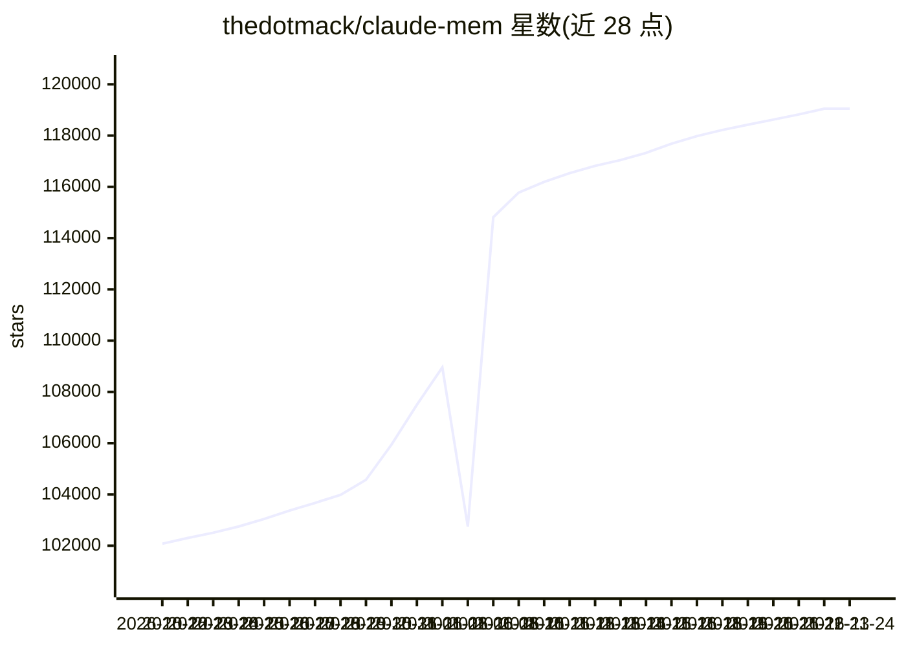

# thedotmack/claude-mem

⭐ 119,048 · TypeScript · Apache-2.0 · 推送 2026-11-22 · [GitHub](https://github.com/thedotmack/claude-mem) · [官网](https://claude-mem.ai) · 个人维护

**为编程 agent 提供跨会话持久记忆的插件工具**

Claude-Mem 通过 agent 生命周期钩子捕获每次工具调用，由本地 worker 服务上的 observer agent 将活动压缩为观察记录与摘要，存入本地 SQLite/Chroma 存储（~/.claude-mem），下一会话按渐进式披露注入相关上下文索引。支持 Claude Code、Codex、Cursor、OpenCode 等 13+ 个 agent，部分 agent 仅支持记忆搜索。提供 mem-search 检索、web 查看器、团队共享工作区与可选云同步；记忆提供方可选 claude-mem observer（30 天试用）、OpenRouter、Gemini 或 Anthropic 计划。通过 npx 安装或 Claude Code 插件市场安装。

## 筛选速览

| 维度 | 判定 | 备注 |
|---|---|---|
| AI 角色 | `ai-ecosystem` | LLM/agent 周边工具 |
| 许可风险 | `permissive` | Apache-2.0 |
| 部署形态 | `desktop` | 安装包/桌面程序 |
| 模型依赖 | — | README 未给出锁定关系 |
| 硬件要求 | — | 无带数字的原话,不猜 |
| 安装摩擦 | `low` | 无编译、无系统依赖或容器化 |
| 成熟度 | — | 结构信号不足 |

## 动量与使用信号

- 维护:`active` — 距上次 push 0.6 天,年发版 100,265 位贡献者
- 涨星:近 1 天 **+217**(自 20261016 起算)
- 安装:npm 包 `claude-mem` 月下载 64,341
- 平台:— · 协议:MCP

## 能力要点

- 钩子捕获工具活动，observer agent 压缩为观察与摘要
- 下一会话注入分层上下文索引，按需取详情以控制 token 开销
- SQLite + FTS5 + Chroma 混合检索，mem-search 三步查询
- 本地存储于 ~/.claude-mem，云同步 opt-in，<private> 标签防敏感内容入库

## 适用场景

- 让编程 agent 在新会话中延续上一次的工作上下文
- 用自然语言检索历史项目会话中的工作记录
- 团队共享 agent 工作清单与发现（TeamBrain）

## 场景标签

`Agent 记忆` · 领域:Agent 开发

## 证据(README 行号)

> L103:  Claude-Mem runs a second agent beside it that takes notes while it works. The next session starts with a short in
> L115: The installer sets everything up first, then asks you to sign in to claude-mem in your browser (email magic link, 
> L239: 1. **Your agent works.** Hooks in your agent hand each tool call (what it reads, edits and runs) to a small local 

## 星数曲线

2026-10-22 102,079 → 2026-11-24 119,048（+16,969）

---
*卡片 v1 · prompt 1.4 · 生成 2026-11-23 · 置信度 high · 依据 README sha `a95999c4989a` · [字段定义](../../DATASET.md)*
