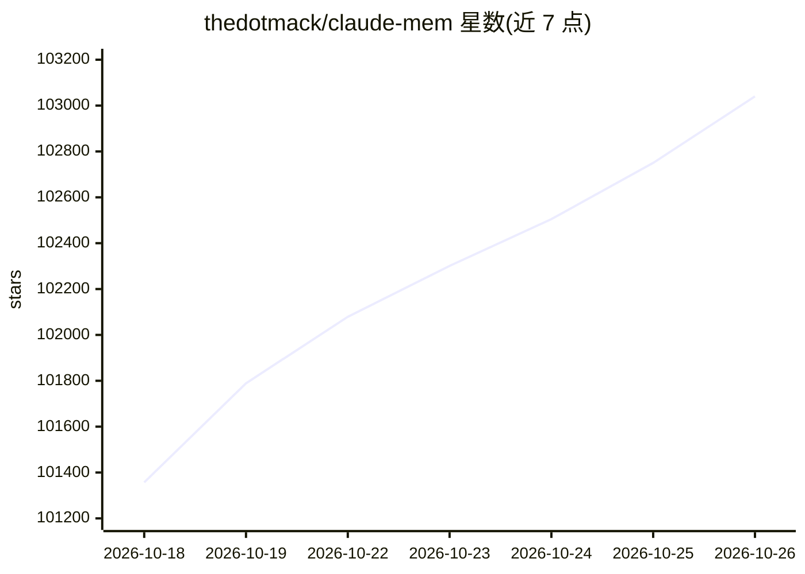

# thedotmack/claude-mem

⭐ 103,040 · TypeScript · Apache-2.0 · 推送 2026-10-25 · [GitHub](https://github.com/thedotmack/claude-mem) · [官网](https://claude-mem.ai) · 个人维护 · 中文 README

**为 AI 编码 Agent 提供跨会话持久记忆的压缩与注入系统**

以 Claude Code 为主要目标的上下文记忆压缩系统：通过生命周期钩子自动捕获会话中的工具使用观察，生成语义摘要存入 SQLite 与 Chroma 向量库，并在后续会话启动时注入相关上下文。提供 4 个 MCP 搜索工具与三层渐进式检索流程以控制 token 消耗，经 npx 安装器或插件市场接入 Claude Code、OpenCode、T3 Code、OpenClaw 等宿主。安装时需登录或显式指定 provider，免费试用结束后回落到 Anthropic 计划。

## 筛选速览

| 维度 | 判定 | 备注 |
|---|---|---|
| AI 角色 | `ai-native` | 本体是模型或模型工具 |
| 许可风险 | `permissive` | Apache-2.0 |
| 部署形态 | `desktop` | 安装包/桌面程序 |
| 模型依赖 | — | README 未给出锁定关系 |
| 硬件要求 | — | 无带数字的原话,不猜 |
| 安装摩擦 | `low` | 无编译、无系统依赖或容器化 |
| 成熟度 | — | 结构信号不足 |

## 动量与使用信号

- 维护:`active` — 距上次 push 0.6 天,年发版 100,265 位贡献者
- 涨星:近 1 天 **+217**(自 20261016 起算)
- 安装:npm 包 `claude-mem` 月下载 64,341
- 平台:— · 协议:MCP

## 能力要点

- 生命周期钩子自动捕获会话观察并生成语义摘要
- SQLite + FTS5 与 Chroma 混合检索（语义+关键词）
- 4 个 MCP 搜索工具，三层渐进式检索节省 token
- 多宿主支持：Claude Code、OpenCode、T3 Code、OpenClaw、Antigravity 等

## 适用场景

- 让编码 Agent 在新会话中延续之前的项目上下文
- 用自然语言检索项目历史操作记录
- 在团队共享记忆空间中协作与交接任务

## 场景标签

`Agent 记忆` · 领域:Agent 开发

## 证据(README 行号)

> L46:  Persistent memory compression system built for Claude Code.
> L103:  Claude-Mem seamlessly preserves context across sessions by automatically capturing tool usage observations, gener
> L235: 1. **Lifecycle Hooks** - SessionStart, UserPromptSubmit, PreToolUse, PostToolUse, Stop, SessionEnd. Each is one sh

## 星数曲线

2026-10-18 101,357 → 2026-10-26 103,040（+1,683）

---
*卡片 v1 · prompt 1.4 · 生成 2026-10-18 · 置信度 high · 依据 README sha `a845d6084b77` · [字段定义](../../DATASET.md)*
