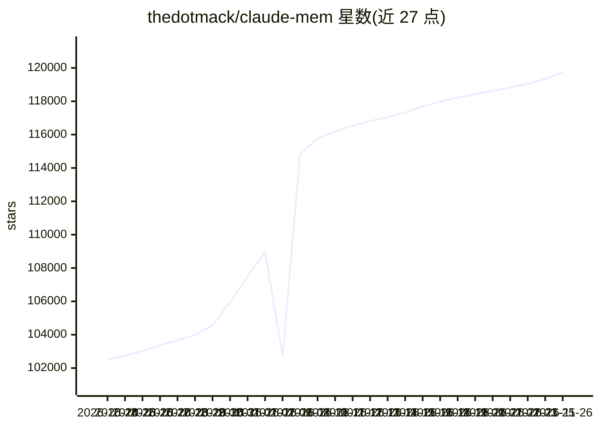

# thedotmack/claude-mem

⭐ 119,760 · TypeScript · Apache-2.0 · 推送 2026-11-25 · [GitHub](https://github.com/thedotmack/claude-mem) · [官网](https://claude-mem.ai) · 个人维护 · 中文 README

**为编码 agent 提供跨会话持久记忆的插件**

通过 hooks 捕获 agent 会话中的工具调用活动，由本地 worker 上运行的第二个 observer agent 将其压缩为观察记录与摘要，存入本地 SQLite/Chroma，下次会话注入相关上下文。支持 Claude Code、Codex、Cursor、OpenCode 等 13+ 个 agent，部分仅支持记忆搜索。本地数据存于 ~/.claude-mem，云同步可选择性开启；记忆压缩模型可选 claude-mem 云端 observer（30 天试用）、自有 Anthropic/OpenRouter/Gemini key 或 Anthropic 套餐。安装用 npx 或 Claude Code 插件市场，数据本地化，敏感内容可用 <private> 标签排除。

## 筛选速览

| 维度 | 判定 | 备注 |
|---|---|---|
| AI 角色 | `ai-ecosystem` | LLM/agent 周边工具 |
| 许可风险 | `permissive` | Apache-2.0 |
| 部署形态 | `desktop` | 安装包/桌面程序 |
| 模型依赖 | — | README 未给出锁定关系 |
| 硬件要求 | — | 无带数字的原话,不猜 |
| 安装摩擦 | `low` | 无编译、无系统依赖或容器化 |
| 成熟度 | — | 结构信号不足 |

## 动量与使用信号

- 维护:`active` — 距上次 push 0.6 天,年发版 100,265 位贡献者
- 涨星:近 1 天 **+217**(自 20261016 起算)
- 安装:npm 包 `claude-mem` 月下载 64,341
- 平台:— · 协议:MCP

## 能力要点

- hooks 捕获工具调用，observer agent 压缩为观察记录
- 分层注入：新会话加载紧凑索引，按需拉取细节
- 混合检索：SQLite FTS5 + Chroma 向量数据库
- mem-search 三步检索与 <private> 标签排除敏感内容

## 适用场景

- 让编码 agent 在新会话延续上次的工作上下文
- 用自然语言检索项目历史中做过的修改
- 团队共享 agent 工作记录与审查队列

## 场景标签

`Agent 记忆` · 领域:Agent 开发

## 证据(README 行号)

> L107:  Claude-Mem runs a second agent beside it that takes notes while it works. The next session starts with a short in
> L243: 1. **Your agent works.** Hooks in your agent hand each tool call (what it reads, edits and runs) to a small local 
> L256: - **Hooks** (`src/cli/hook-command.ts`, one adapter per agent in `src/cli/adapters/`): each agent event runs one s

## 星数曲线

2026-10-24 102,505 → 2026-11-26 119,760（+17,255）

---
*卡片 v1 · prompt 1.4 · 生成 2026-11-26 · 置信度 high · 依据 README sha `96d50a1e5b38` · [字段定义](../../DATASET.md)*
