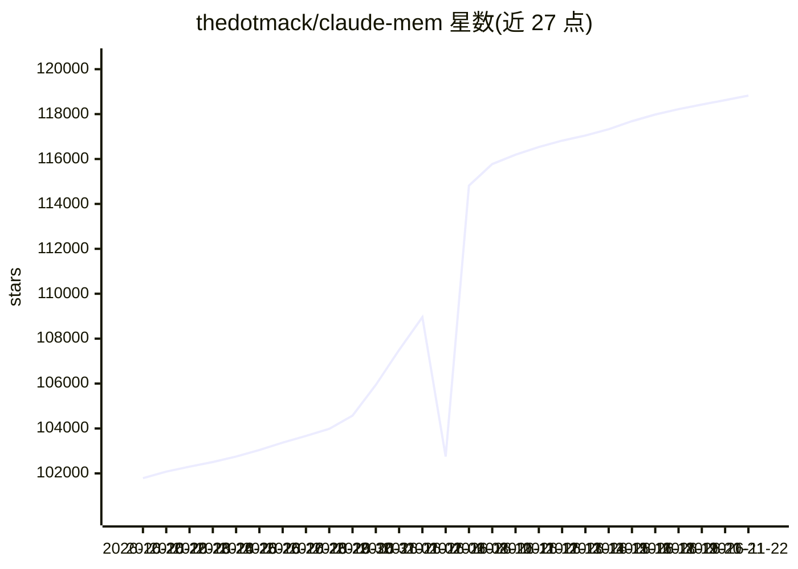

# thedotmack/claude-mem

⭐ 118,823 · TypeScript · Apache-2.0 · 推送 2026-11-21 · [GitHub](https://github.com/thedotmack/claude-mem) · [官网](https://claude-mem.ai) · 个人维护

**为编码 agent 提供跨会话持久记忆与上下文注入**

Claude-Mem 在用户现有编码 agent（Claude Code、Codex、OpenCode 等 15 个以上）旁运行第二个观察 agent：通过生命周期钩子把工具调用交给本地 worker，由观察者生成观察记录与会话摘要，存储在本地 ~/.claude-mem（SQLite + FTS5 + Chroma 向量检索）。下次会话以紧凑索引开场，按需拉取详情；mem-search 技能支持三步检索。worker 由 Bun 管理，提供 viewer 与 HTTP API；支持选择观察者、OpenRouter、Gemini key 或 Anthropic 计划作为记忆提供方，观察者含 30 天试用。

## 筛选速览

| 维度 | 判定 | 备注 |
|---|---|---|
| AI 角色 | `ai-ecosystem` | LLM/agent 周边工具 |
| 许可风险 | `permissive` | Apache-2.0 |
| 部署形态 | `desktop` | 安装包/桌面程序 |
| 模型依赖 | — | README 未给出锁定关系 |
| 硬件要求 | — | 无带数字的原话,不猜 |
| 安装摩擦 | `low` | 无编译、无系统依赖或容器化 |
| 成熟度 | — | 结构信号不足 |

## 动量与使用信号

- 维护:`active` — 距上次 push 0.6 天,年发版 100,265 位贡献者
- 涨星:近 1 天 **+217**(自 20261016 起算)
- 安装:npm 包 `claude-mem` 月下载 64,341
- 平台:— · 协议:MCP

## 能力要点

- 钩子捕获工具活动，观察 agent 压缩为观察与摘要
- SQLite + FTS5 + Chroma 的混合检索，渐进式上下文注入
- 支持 15 个以上编码 agent，含 OpenClaw 网关插件
- 本地存储，`<private>` 标签内容不存储，遥测可关闭

## 适用场景

- 让 agent 在新会话中延续上一会话的工作进展
- 用自然语言检索项目历史操作记录
- 团队通过 TeamBrain 共享工作清单与发现

## 场景标签

`Agent 记忆` · 领域:Agent 开发

## 证据(README 行号)

> L103:  Claude-Mem runs a second agent beside it that takes notes while it works. The next session starts with a short in
> L240: 2. **The observer takes notes.** A second agent turns that activity into short observations, and writes a summary 
> L254: - **The observer** (prompts in `src/sdk/`, one provider per model source in `src/services/worker/`, such as `Claud

## 星数曲线

2026-10-20 101,789 → 2026-11-22 118,823（+17,034）

---
*卡片 v1 · prompt 1.4 · 生成 2026-11-22 · 置信度 high · 依据 README sha `bfc657d6c610` · [字段定义](../../DATASET.md)*
