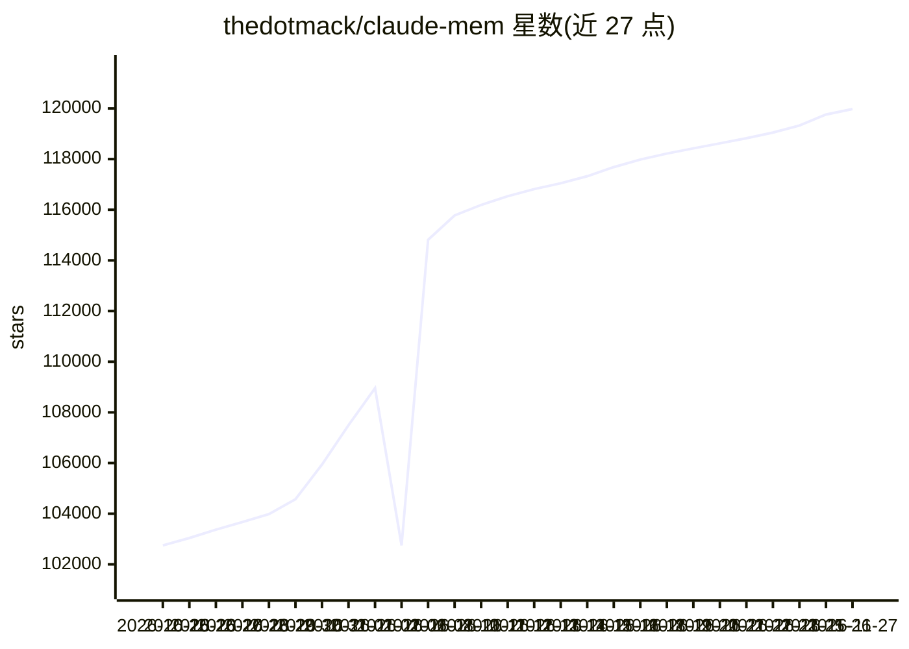

# thedotmack/claude-mem

⭐ 119,976 · TypeScript · Apache-2.0 · 推送 2026-11-26 · [GitHub](https://github.com/thedotmack/claude-mem) · [官网](https://claude-mem.ai) · 个人维护 · 中文 README

**为编码 agent 提供跨会话持久记忆的插件**

Claude-Mem 在本地运行一个伴随 agent：通过宿主 agent 的生命周期钩子捕获每次工具调用，由观察者 agent 压缩为简短观察记录，写入本地 SQLite（FTS5）与 Chroma 向量库的混合检索存储；下次会话自动注入分层的上下文索引，并按需拉取细节。通过 npx 安装器或 Claude Code 插件市场部署，支持 Claude Code、Codex、Cursor、OpenCode 等 13+ 个 agent，部分 agent 仅支持记忆搜索。记忆默认存于本机 ~/.claude-mem，云同步为可选，匿名遥测默认开启、可关闭。观察者提供 30 天免费试用，之后回退到用户自有模型配置。

## 筛选速览

| 维度 | 判定 | 备注 |
|---|---|---|
| AI 角色 | `ai-ecosystem` | LLM/agent 周边工具 |
| 许可风险 | `permissive` | Apache-2.0 |
| 部署形态 | `desktop` | 安装包/桌面程序 |
| 模型依赖 | — | README 未给出锁定关系 |
| 硬件要求 | — | 无带数字的原话,不猜 |
| 安装摩擦 | `low` | 无编译、无系统依赖或容器化 |
| 成熟度 | — | 结构信号不足 |

## 动量与使用信号

- 维护:`active` — 距上次 push 0.6 天,年发版 100,265 位贡献者
- 涨星:近 1 天 **+217**(自 20261016 起算)
- 安装:npm 包 `claude-mem` 月下载 64,341
- 平台:— · 协议:MCP

## 能力要点

- 钩子捕获工具调用，观察者 agent 生成会话观察与摘要
- SQLite FTS5 + Chroma 向量库混合检索，三层渐进式上下文注入
- 支持 Claude Code、Codex、Cursor、OpenCode 等 13+ agent，部分仅搜索
- 本地 ~/.claude-mem 存储，云同步 opt-in，<private> 标签可阻止存储

## 适用场景

- 让新会话直接继承上次编码会话的修复与决策上下文
- 用自然语言检索历史项目工作记录（索引/时间线/详情三步）
- 团队共享工作列表与成员归属（TeamBrain 可选）
- 从 Claude Desktop 对话中搜索记忆

## 场景标签

`Agent 记忆` · 领域:Agent 开发

## 证据(README 行号)

> L107:  Claude-Mem runs a second agent beside it that takes notes while it works. The next session starts with a short in
> L243: 1. **Your agent works.** Hooks in your agent hand each tool call (what it reads, edits and runs) to a small local 
> L257: - **The worker** (`src/services/worker-service.ts`, routes in `src/services/worker/http/routes/`): a local HTTP se

## 星数曲线

2026-10-25 102,750 → 2026-11-27 119,976（+17,226）

---
*卡片 v1 · prompt 1.4 · 生成 2026-11-27 · 置信度 high · 依据 README sha `b60e7dea2ffb` · [字段定义](../../DATASET.md)*
