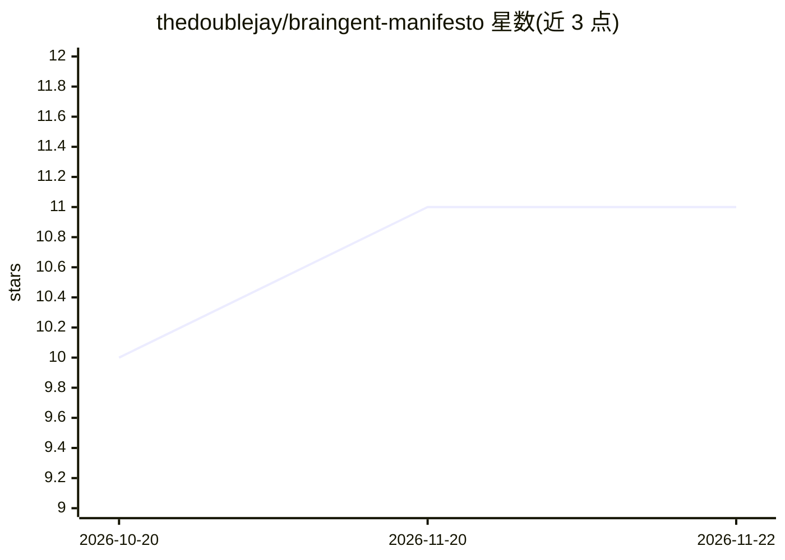

# thedoublejay/braingent-manifesto

⭐ 11 · Python · MIT · 推送 2026-11-12 · [GitHub](https://github.com/thedoublejay/braingent-manifesto) · [官网](https://braingent.dev/) · 个人维护

**面向开发者的 Markdown+Git AI 编码 agent 记忆库**

开源的 Markdown-first 记忆系统 starter kit 加可安装的 braingent Python CLI：用 braingent init 生成一个 Markdown 记忆仓库，供 Claude、Codex、ChatGPT、Gemini CLI 等编码 agent 在规划前检索上下文、在工作后写入任务/决策/评审/学习记录；Markdown 为唯一事实来源，CLI 提供索引重建、结构化检索、健康检查、模板更新等辅助命令，可选 MCP server 暴露检索工具。仓库需提交 Git，无服务器。要求 Python 3.11+ 与 pipx/uv。

## 筛选速览

| 维度 | 判定 | 备注 |
|---|---|---|
| AI 角色 | `ai-ecosystem` | LLM/agent 周边工具 |
| 许可风险 | `permissive` | MIT |
| 部署形态 | `library` | 以包/库形式分发 |
| 模型依赖 | — | README 未给出锁定关系 |
| 硬件要求 | — | 无带数字的原话,不猜 |
| 安装摩擦 | `low` | 无编译、无系统依赖或容器化 |
| 成熟度 | — | 结构信号不足 |

## 能力要点

- braingent init 生成 Markdown 记忆仓库，Git 提交管理，无需服务器
- CLI 提供检索（find/recall）、索引重建、doctor 健康检查、模板保守更新
- 可选 [mcp] extra 提供 MCP 检索服务器（braingent mcp serve）
- 生成 AGENTS.md/CLAUDE.md/CHATGPT_PROJECT_BRIEF.md/GEMINI.md 等 agent 入口文件与 BGT-NNNN 任务协调

## 适用场景

- 编码 agent 会话反复丢失项目上下文时，让其先检索记忆库再规划
- 在 Git 中沉淀任务、决策、评审、学习等工程记录供 agent 复用
- 用 tasks/ 目录在多个 agent 会话间协调进行中的工作

## 场景标签

`Agent 记忆` · 领域:Agent 开发

## 证据(README 行号)

> L26: Braingent is a Markdown-first memory system for software engineers who work
> L33: starter kit plus the source for the installable `braingent` Python CLI. Install
> L130: The `braingent` command is a thin helper around a Markdown repo — it never

## 星数曲线

2026-10-20 10 → 2026-11-22 11（+1）

---
*卡片 v1 · prompt 1.4 · 生成 2026-11-19 · 置信度 high · 依据 README sha `f29d744408ac` · [字段定义](../../DATASET.md)*
