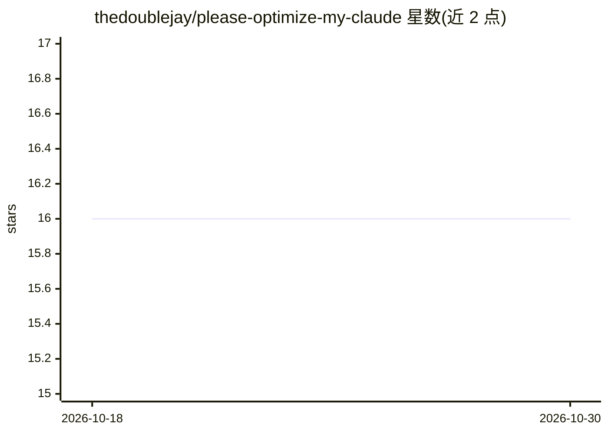

# thedoublejay/please-optimize-my-claude

⭐ 16 · MIT · 推送 2026-04-09 · [GitHub](https://github.com/thedoublejay/please-optimize-my-claude) · 个人维护

**优化 CLAUDE.md 层级结构的 Claude Code 技能：去重、检测错位与压缩**

面向 Claude Code 用户的 SKILL.md 技能：发现全局/组织/项目各层级的 CLAUDE.md、CLAUDE.local.md、.claude/rules/ 与 @import 引用，运行 9 类检测器（重复、错位、臃肿、过期、矛盾、token 预算、最佳实践、缺失索引、安全扫描），生成 Unicode 可视化报告并按 interactive/auto/analyze 三种模式应用修改，附备份与恢复机制。token 估算采用词数×1.5，设计且仅在 Claude Code 中测试，其他 agent 中 analyze 只读模式效果最佳。

## 筛选速览

| 维度 | 判定 | 备注 |
|---|---|---|
| AI 角色 | `ai-ecosystem` | LLM/agent 周边工具 |
| 许可风险 | `permissive` | MIT |
| 部署形态 | `library` | 以包/库形式分发 |
| 模型依赖 | — | README 未给出锁定关系 |
| 硬件要求 | — | 无带数字的原话,不猜 |
| 安装摩擦 | `low` | 无编译、无系统依赖或容器化 |
| 成熟度 | — | 结构信号不足 |

## 能力要点

- 5 阶段流水线与 9 类检测器（含安全扫描与矛盾检测）
- 层级树、token 条形图与 What Claude Sees 模拟器等可视化报告
- interactive/auto/analyze 三模式，附带范围匹配的备份与 restore 命令
- git blame 与 package.json 脚本校验检测过期内容

## 适用场景

- 多项目环境下精简全局 CLAUDE.md，把组织/项目专属规则下沉到正确层级
- 查看每个工作目录实际加载的 token 数并发现超预算文件
- 检测误提交的密钥、凭据与 PII 并获得替换建议

## 场景标签

`提示工程` · 领域:Agent 开发

## 证据(README 行号)

> L3: > Optimize your CLAUDE.md hierarchy — deduplicate content, detect misplacement, compress bloat, and visualize token 
> L159: This skill is **designed for and tested with Claude Code**. CLAUDE.md is a Claude Code convention — the hierarchic

## 星数曲线

2026-10-18 16 → 2026-10-30 16（+0）

---
*卡片 v1 · prompt 1.4 · 生成 2026-10-30 · 置信度 high · 依据 README sha `90d4d3fe9c28` · [字段定义](../../DATASET.md)*
