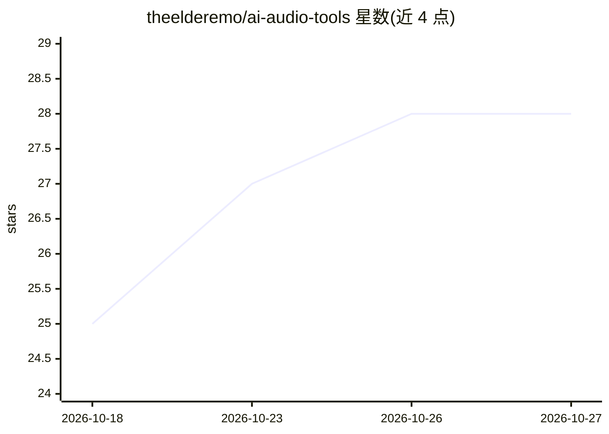

# theelderemo/ai-audio-tools

⭐ 28 · JavaScript · NOASSERTION · 推送 2026-10-23 · [GitHub](https://github.com/theelderemo/ai-audio-tools) · [官网](ai-audio-tools.com) · 个人维护

**AI 音频与音乐工具社区策展清单，按任务分类导航**

收录音频与音乐领域 AI 工具的 awesome-list，条目按创作生产、歌词写作、语音翻唱、源分离、母带处理、插件、分析推荐、健康、播客、听力与声音检测等类别组织，并配以'I want to...'任务导航表帮助用户按需求查找。每个条目标注 free/freemium/paid/api/open-source/vst/hardware 等徽章及简述，另提供交互式索引页面。面向寻找音频 AI 工具的创作者与开发者，本身不含可安装的软件。

## 筛选速览

| 维度 | 判定 | 备注 |
|---|---|---|
| AI 角色 | `ai-knowledge` | 知识聚合/清单类 |
| 许可风险 | `none` | NOASSERTION |
| 部署形态 | `None` |  |
| 模型依赖 | — | README 未给出锁定关系 |
| 硬件要求 | — | 无带数字的原话,不猜 |
| 安装摩擦 | `low` | 无编译、无系统依赖或容器化 |
| 成熟度 | — | 结构信号不足 |

## 能力要点

- 按任务场景组织的分类导航表（I want to...）
- 条目附免费/付费/API/开源/插件等徽章标注
- 覆盖创作、分离、语音克隆、健康、播客等 10+ 类别

## 适用场景

- 找能从文本生成完整歌曲的 AI 工具
- 查找人声分离或翻唱生成的服务
- 按免费/开源/付费徽章筛选音频工具

## 场景标签

`精选清单` · 领域:学习与行业

## 证据(README 行号)

> L10: **Browse the interactive index ↗**
> L16: |Make a full song from scratch|Creation & Production|
> L27: |Creation & Production|Lyric Writing|Voice Covers|Separation|

## 星数曲线

2026-10-18 25 → 2026-10-27 28（+3）

---
*卡片 v1 · prompt 1.4 · 生成 2026-10-26 · 置信度 high · 依据 README sha `2b058ecc9b0f` · [字段定义](../../DATASET.md)*
