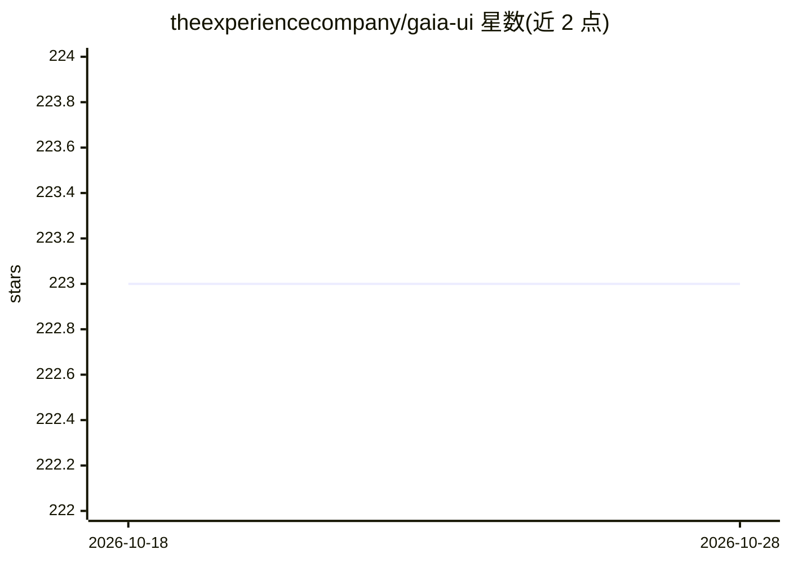

# theexperiencecompany/gaia-ui

⭐ 223 · TypeScript · MIT · 推送 2026-09-03 · [GitHub](https://github.com/theexperiencecompany/gaia-ui) · [官网](https://ui.heygaia.io) · 组织维护

**面向 AI 助手/聊天界面的 React UI 组件注册表**

由 GAIA 团队维护的生产级 UI 组件集合，专用于构建 AI 助手与聊天机器人界面（如 chat-bubble、tool-calls-section）。组件通过 npx @heygaia/ui 或 shadcn CLI 从 registry 拉取到用户项目，基于 shadcn/ui 标准组件，构建于 Next.js 15、Tailwind CSS v4、Radix UI、Framer Motion 之上。库处于 beta 阶段（正从内部代码库迁移组件，v1.0 前 API 可能变动），但自称已在生产环境使用。MIT 许可。

## 筛选速览

| 维度 | 判定 | 备注 |
|---|---|---|
| AI 角色 | `ai-ecosystem` | LLM/agent 周边工具 |
| 许可风险 | `permissive` | MIT |
| 部署形态 | `library` | 以包/库形式分发 |
| 模型依赖 | — | README 未给出锁定关系 |
| 硬件要求 | — | 无带数字的原话,不猜 |
| 安装摩擦 | `low` | 无编译、无系统依赖或容器化 |
| 成熟度 | `idea` | |

## 能力要点

- 针对对话式界面的组件（chat-bubble、tool-calls-section 等）
- 通过 npx @heygaia/ui 或 shadcn CLI 按 registry 拉取组件
- 基于 shadcn/ui 标准，使用 Radix UI 无障碍原语与 Framer Motion

## 适用场景

- 为 AI 助手或聊天产品快速搭建对话界面
- 在已有 shadcn/ui 项目中按需引入对话类组件

## 场景标签

 · 领域:前端/UI 组件

## 证据(README 行号)

> L11: A collection of production-ready UI components designed specifically for building AI assistants and chatbots. These
> L88: GAIA UI is in **beta**. We're actively migrating components from our internal GAIA codebase, replacing HeroUI with 

## 星数曲线

2026-10-18 223 → 2026-10-28 223（+0）

---
*卡片 v1 · prompt 1.4 · 生成 2026-10-22 · 置信度 high · 依据 README sha `1ae80e500de1` · [字段定义](../../DATASET.md)*
