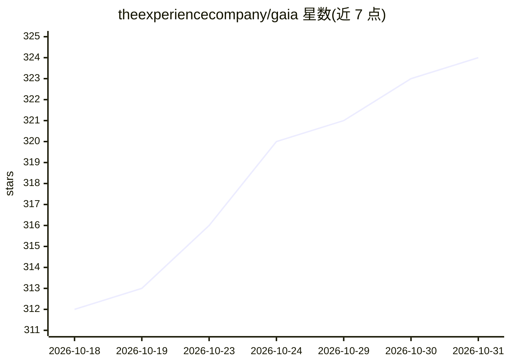

# theexperiencecompany/gaia

⭐ 324 · Python · NOASSERTION · 推送 2026-10-29 · [GitHub](https://github.com/theexperiencecompany/gaia) · [官网](https://heygaia.io) · 组织维护

**开源个人 AI 助理：自动处理邮件、日历与跨应用事务**

面向个人用户的全天候 AI 助理：接入 Gmail 后每日分诊收件箱并起草回复，接入日历后生成会前简报与提醒；通过 iMessage、WhatsApp、Telegram、Slack、Discord 及网页/桌面/移动端对话。支持自然语言生成定时或事件触发的工作流、记忆管理、语音唤醒、沙箱代码执行、浏览器操作与 MCP 工具接入。提供云端服务与 Docker 自托管两种使用方式；自托管需 Docker（Engine 20.10+、Compose v2+）与 Node.js 20+，并运行 Postgres、Mongo、Redis、ChromaDB、RabbitMQ 等基础设施。许可为 PolyForm Noncommercial，商用需企业许可。

## 筛选速览

| 维度 | 判定 | 备注 |
|---|---|---|
| AI 角色 | `ai-native` | 本体是模型或模型工具 |
| 许可风险 | `none` | NOASSERTION |
| 部署形态 | `library` | 以包/库形式分发 |
| 模型依赖 | — | README 未给出锁定关系 |
| 硬件要求 | — | 无带数字的原话,不猜 |
| 安装摩擦 | `low` | 无编译、无系统依赖或容器化 |
| 成熟度 | — | 结构信号不足 |

## 能力要点

- 接入工具即自动运行的主动式工作流（邮件分诊、会前简报、会议提醒）
- 自然语言描述即可生成定时/事件触发的跨工具自动化
- 三层 agent 架构：通信 agent 只委派，各集成专属 agent 并行执行
- MCP 协议接入任意工具，gaia bridge 连接本地电脑文件与工具

## 适用场景

- 让 AI 每天早晨分诊邮件、起草回复并汇总待办
- 会前自动研究参会人与议题生成简报
- 用自然语言创建定时/事件驱动的跨应用自动化任务
- 通过聊天软件（iMessage/WhatsApp/Telegram 等）随时指挥助理完成任务

## 场景标签

`AI 助手` `工作流自动化` · 领域:效率与自动化

## 证据(README 行号)

> L9: GAIA is a personal AI assistant that can automate your whole day. Connect Gmail and it triages your inbox every morn
> L26: - **Proactive** — connect a tool and jobs start running on their own, no setup
> L108: - **"Summarise my 47 unread emails and draft replies for the 3 that need one."** Reads every thread end to end, ra

## 星数曲线

2026-10-18 312 → 2026-10-31 324（+12）

---
*卡片 v1 · prompt 1.4 · 生成 2026-10-21 · 置信度 high · 依据 README sha `db9fd97ca798` · [字段定义](../../DATASET.md)*
