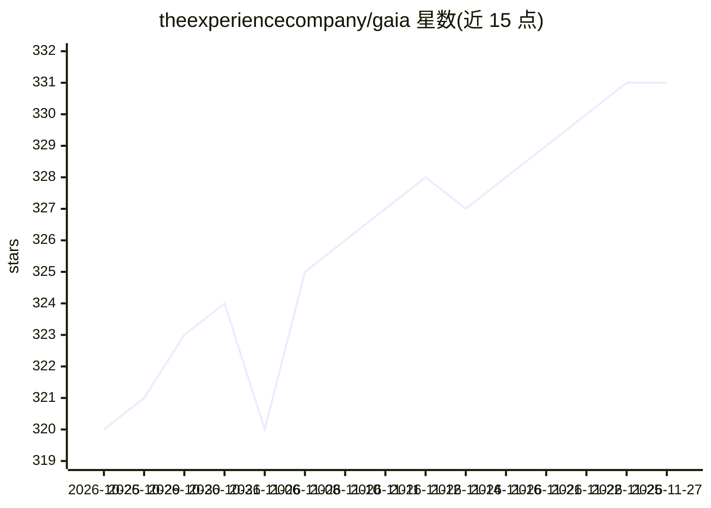

# theexperiencecompany/gaia

⭐ 331 · Python · NOASSERTION · 推送 2026-11-26 · [GitHub](https://github.com/theexperiencecompany/gaia) · [官网](https://heygaia.io) · 组织维护

**面向个人的主动式 AI 助手：自动打理邮件、日程与待办**

开源个人 AI 助手，连接 Gmail、日历、Slack、Notion 等工具后自动运行日常任务：早晨分拣邮件并起草回复、会前做简报、跨应用同步待办。支持用自然语言描述创建定时或事件触发的工作流，通过 iMessage、WhatsApp、Telegram、Slack、Discord、网页、桌面与移动端多渠道交互。内置记忆、语音唤醒、沙盒代码执行、浏览器操作与深度研究能力，集成通过 MCP 扩展。采用三层 agent 架构，通讯 agent 只做委派以保持响应。云端托管为付费服务，自托管免费但许可证为非商业用途。

## 筛选速览

| 维度 | 判定 | 备注 |
|---|---|---|
| AI 角色 | `ai-native` | 本体是模型或模型工具 |
| 许可风险 | `none` | NOASSERTION |
| 部署形态 | `None` |  |
| 模型依赖 | local-ok | 支持本地模型 |
| 硬件要求 | — | 无带数字的原话,不猜 |
| 安装摩擦 | `low` | 无编译、无系统依赖或容器化 |
| 成熟度 | — | 结构信号不足 |

## 能力要点

- 连接工具后自动运行工作流，无需配置（邮件分拣、会前简报、会议提醒）
- 多平台触达：iMessage、WhatsApp、Telegram、Slack、Discord、网页、桌面与移动端共用一个账户
- 支持 MCP 接入任意工具，gaia bridge 连接本机文件与工具
- 沙盒代码执行产出 PDF/表格/幻灯片，多源深度研究输出结构化结果

## 适用场景

- 每天自动分拣 Gmail 收件箱并起草回复
- 会前自动调研与会者和会议主题
- 用自然语言创建定时或事件触发的自动化任务
- 在自己服务器上自托管并使用自己的 API key

## 场景标签

`AI 助手` · 领域:对话与助手

## 证据(README 行号)

> L8: **The open-source AI assistant that handles your whole day.**
> L12: GAIA is a personal AI assistant that can automate your whole day. Connect Gmail and it triages your inbox every mor
> L75: **You need:** a Linux server or Mac with about 8 GB of RAM, and one AI key (OpenAI, OpenRouter, Gemini, or a local 

## 星数曲线

2026-10-25 320 → 2026-11-27 331（+11）

---
*卡片 v1 · prompt 1.4 · 生成 2026-11-25 · 置信度 high · 依据 README sha `cb785cf2dc33` · [字段定义](../../DATASET.md)*
