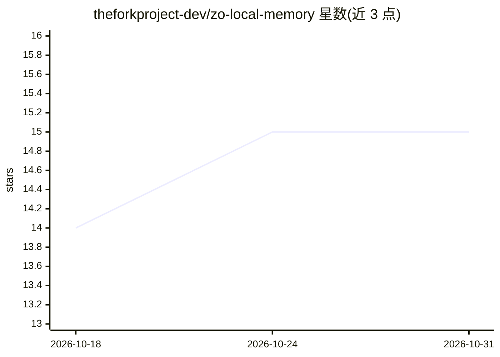

# theforkproject-dev/zo-local-memory

⭐ 15 · Python · MIT · 推送 2026-01-16 · [GitHub](https://github.com/theforkproject-dev/zo-local-memory) · [官网](https://tools-hub-fork.zocomputer.io) · 组织维护

**为 Zo Computer 提供完全本地化的持久 AI 记忆系统**

面向 Zo Computer（带 root 权限）的本地语义记忆工具：用 Ollama（nomic-embed-text）生成 768 维本地嵌入，Turso(sqld) 作为本地向量数据库，Python 客户端负责存取。安装后 Zo 在会话间自动记忆对话、保存偏好与决策、维护身份连续性，用户无需手动管理记忆。架构借鉴 Memory Box 平台的语义记忆模型（命名空间隔离、会话桥接、记忆分类）。可通过让 Zo 自行安装或 curl 脚本手动安装，需约 500MB 磁盘与 Python 3.12+（Zo 自带）。

## 筛选速览

| 维度 | 判定 | 备注 |
|---|---|---|
| AI 角色 | `ai-ecosystem` | LLM/agent 周边工具 |
| 许可风险 | `permissive` | MIT |
| 部署形态 | `None` |  |
| 模型依赖 | local-ok | 支持本地模型 |
| 硬件要求 | — | 无带数字的原话,不猜 |
| 安装摩擦 | `low` | 无编译、无系统依赖或容器化 |
| 成熟度 | — | 结构信号不足 |

## 能力要点

- Ollama 本地嵌入 + Turso 本地向量数据库，全本地运行
- 跨会话持久记忆与语义检索
- Zo 可通过自然语言指令自行完成安装
- 借鉴 Memory Box 的语义记忆模型（命名空间隔离/会话桥接）

## 适用场景

- 让我的 Zo AI 在重启后仍记得之前的对话和偏好
- 在完全本地、无外部 API 的前提下为 AI 建立长期记忆
- 为多个 agent 维护各自隔离的记忆命名空间

## 场景标签

`Agent 记忆` · 领域:Agent 开发

## 证据(README 行号)

> L66: Once installed, Zo automatically:
> L82: * **Ollama** (nomic-embed-text) - Local 768D embeddings

## 星数曲线

2026-10-18 14 → 2026-10-31 15（+1）

---
*卡片 v1 · prompt 1.4 · 生成 2026-10-30 · 置信度 high · 依据 README sha `bd03d81840eb` · [字段定义](../../DATASET.md)*
