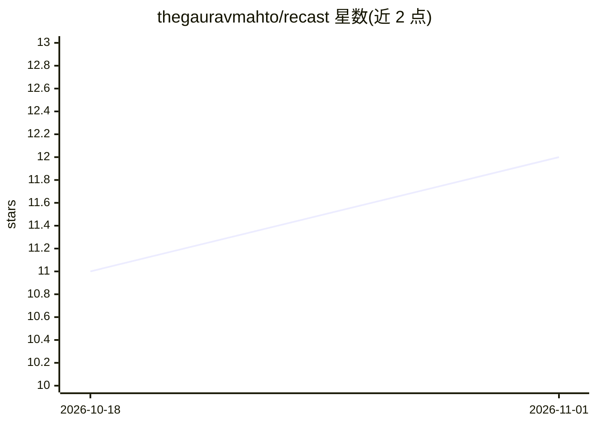

# thegauravmahto/recast

⭐ 12 · TypeScript · 推送 2026-05-24 · [GitHub](https://github.com/thegauravmahto/recast) · 个人维护 · 中文 README

**粘贴视频链接生成品牌适配广告脚本的 AI 应用**

基于 Next.js 的 Web 应用：用户粘贴 Reel/Short/TikTok/Facebook 广告链接，服务端用 yt-dlp 下载视频（可选 ffmpeg 提取音频），经 Gemini Files API 上传后由 Gemini 2.5 Flash 分析，输出视频结构拆解、改写钩子、30-45 秒脚本、Instagram 文案与拍摄视觉指导五类资产，保留源视频原语言。需配置 Google API key（Gemini）方可运行，依赖 Node.js 18+、yt-dlp 与 ffmpeg。面向营销人员、创作者与代理团队。

## 筛选速览

| 维度 | 判定 | 备注 |
|---|---|---|
| AI 角色 | `ai-native` | 本体是模型或模型工具 |
| 许可风险 | `none` | — |
| 部署形态 | `library` | 以包/库形式分发 |
| 模型依赖 | — | README 未给出锁定关系 |
| 硬件要求 | — | 无带数字的原话,不猜 |
| 安装摩擦 | `medium` | 含编译或系统依赖之一 |
| 成熟度 | — | 结构信号不足 |

## 能力要点

- 单链接输入，支持 Reel/Short/TikTok/FB 广告及 yt-dlp 覆盖的 1000+ 站点
- 一次生成 5 类资产：摘要、钩子、脚本、文案、视觉指导
- 输出保留源视频原语言（Hindi/Tamil/Hinglish 等）
- 可切换纯音频转录模式以缩减上传量

## 适用场景

- 把刷到的爆款视频快速改写成自家品牌口吻的广告脚本
- D2C 团队批量产出多平台广告变体
- 代理商把竞品扫描快速转化为客户方案

## 场景标签

`AI 写作` `多模态` · 领域:内容生成

## 证据(README 行号)

> L5:  Paste a Reel, Short, TikTok, or Facebook Ad → get an on-brand script, hook, caption, and visual direction powered b
> L181: 5. **AI Analysis** — Gemini 2.5 Flash runs with a specialized system prompt and returns structured markdown with 5

## 星数曲线

2026-10-18 11 → 2026-11-01 12（+1）

---
*卡片 v1 · prompt 1.4 · 生成 2026-10-31 · 置信度 mid · 依据 README sha `0faa80681b0e` · [字段定义](../../DATASET.md)*
