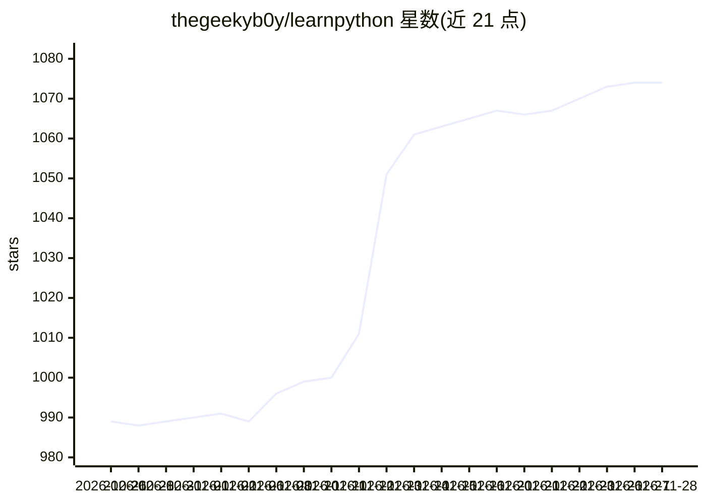

# thegeekyb0y/learnpython

⭐ 1,074 · TypeScript · MIT · 推送 2026-11-25 · [GitHub](https://github.com/thegeekyb0y/learnpython) · [官网](https://thegeekyb0y.github.io/learnpython/) · 个人维护

**为 Python 学习者整理的教程、速查表与 AI 开发资源链接清单**

一个以链接表形式组织的 Python 学习资源清单：覆盖官方文档、入门路线图、YouTube 播放列表、博客、速查表、播客等通用内容；另设 AI/机器学习专章，按生成式 AI 与 LLM API、ML 框架、向量数据库与 RAG、AI 编程助手、Agent 框架、MCP、LLM 应用评测、本地模型运行、从零构建 LLM 等主题分类罗列文档与教程链接，部分条目标注难度等级（Beginner/Intermediate/Advanced）。本身不含代码或安装步骤，仅作资源索引。

## 筛选速览

| 维度 | 判定 | 备注 |
|---|---|---|
| AI 角色 | `ai-knowledge` | 知识聚合/清单类 |
| 许可风险 | `permissive` | MIT |
| 部署形态 | `None` |  |
| 模型依赖 | — | README 未给出锁定关系 |
| 硬件要求 | — | 无带数字的原话,不猜 |
| 安装摩擦 | `low` | 无编译、无系统依赖或容器化 |
| 成熟度 | — | 结构信号不足 |

## 能力要点

- 按主题分类的 Python 学习资源链接表（教程/速查表/播客/博客）
- AI 与机器学习章节按 LLM API、RAG、Agent、MCP、评测等子主题组织
- 部分 AI 资源条目附 Beginner/Intermediate/Advanced 难度标注

## 适用场景

- 入门 Python 时查找教程、速查表与练习资源
- 想用 Python 接入 LLM 或构建 Agent 时查找对应文档入口
- 寻找本地运行开源模型或从零实现 GPT 的学习材料

## 场景标签

`精选清单` · 领域:学习与行业

## 证据(README 行号)

> L14: |Info|Link|
> L143: ### Generative AI & Large Language Models
> L261: |Resource Name|Link|Notes|

## 星数曲线

2026-10-26 989 → 2026-11-28 1,074（+85）

---
*卡片 v1 · prompt 1.4 · 生成 2026-11-26 · 置信度 high · 依据 README sha `fd7996aad892` · [字段定义](../../DATASET.md)*
