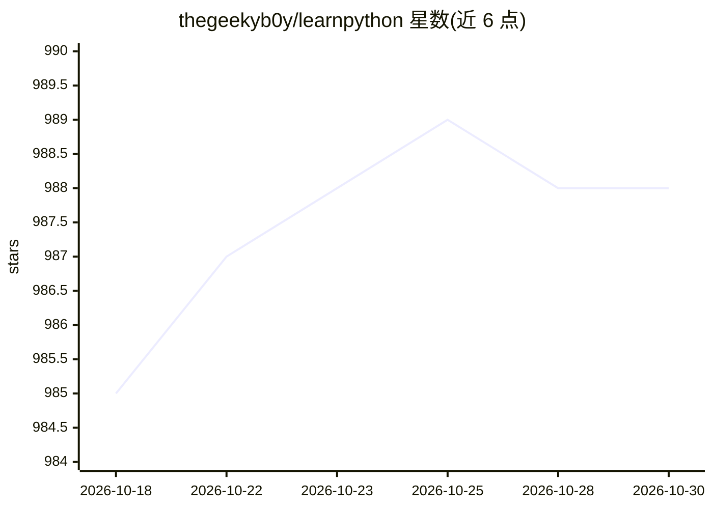

# thegeekyb0y/learnpython

⭐ 988 · MIT · 推送 2026-08-18 · [GitHub](https://github.com/thegeekyb0y/learnpython) · 个人维护

**Python 学习资源清单：覆盖入门到 AI/LLM 开发的链接合集**

由个人维护的 Python 学习资源聚合清单：收录基础教程、YouTube 频道、博客、速查表、播客及 Twitter 创作者链接，并按领域扩展到数据科学、机器学习与区块链。AI 部分覆盖生成式 AI/LLM API 文档、ML 框架、向量数据库与 RAG、AI 编程工具、Agent 框架、MCP、LLM 评测工具、本地模型运行方案及从零构建 LLM 的资源，均以表格链接形式组织并标注难度。本体为链接目录，无可安装代码。

## 筛选速览

| 维度 | 判定 | 备注 |
|---|---|---|
| AI 角色 | `ai-knowledge` | 知识聚合/清单类 |
| 许可风险 | `permissive` | MIT |
| 部署形态 | `None` |  |
| 模型依赖 | — | README 未给出锁定关系 |
| 硬件要求 | — | 无带数字的原话,不猜 |
| 安装摩擦 | `low` | 无编译、无系统依赖或容器化 |
| 成熟度 | — | 结构信号不足 |

## 能力要点

- 基础到进阶的 Python 学习资源分类清单（教程/频道/博客/速查表/播客）
- AI/ML 资源覆盖 LLM API、框架、RAG、Agent、MCP、评测等主题
- 含本地开源 LLM 运行与从零构建 LLM 的资源条目
- 多数 AI 资源条目附难度标注（Beginner/Intermediate/Advanced）

## 适用场景

- 初学者按清单找到 Python 入门路线与课程
- 开发者查找 LLM/Agent 开发的框架与文档入口
- 选择本地运行开源模型的 Python 工具

## 场景标签

`精选清单` · 领域:学习与行业

## 证据(README 行号)

> L141: ## AI & Machine Learning with Python 🤖
> L247: ## Running Local & Open-Source LLMs with Python 🖥️

## 星数曲线

2026-10-18 985 → 2026-10-30 988（+3）

---
*卡片 v1 · prompt 1.4 · 生成 2026-10-21 · 置信度 high · 依据 README sha `f968c7d3b4cf` · [字段定义](../../DATASET.md)*
