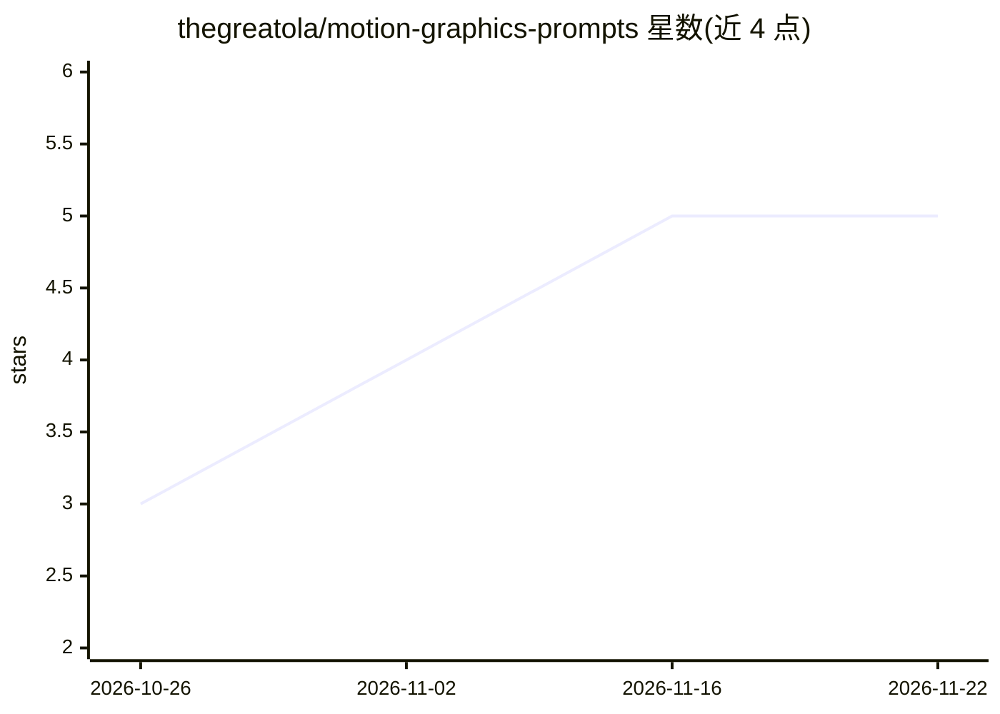

# thegreatola/motion-graphics-prompts

⭐ 5 · MIT · 推送 2026-10-13 · [GitHub](https://github.com/thegreatola/motion-graphics-prompts) · [官网](https://x.com/thegreatola) · 个人维护

**让编码 agent 生成产品视频的提示词合集（23 个版本）**

一份提示词资源库：提供 1 个主提示词及按画幅（16:9/9:16/1:1/4:5）、时长（15–90 秒）、产品类型（Web 应用、移动应用、聊天机器人、CLI 等）和目标（发布视频、功能公告、广告、教程等）划分的 23 个版本，以及风格块与后续反馈提示词。使用方式是把提示词粘贴进项目文件夹内的编码 agent（为 Claude Code 编写并测试），由 agent 读取代码、用 Remotion 渲染动画并生成配乐，导出视频。需 Node.js；无代码访问的场景提供基于截图的提示词。MIT 许可。

## 筛选速览

| 维度 | 判定 | 备注 |
|---|---|---|
| AI 角色 | `ai-knowledge` | 知识聚合/清单类 |
| 许可风险 | `permissive` | MIT |
| 部署形态 | `None` |  |
| 模型依赖 | — | README 未给出锁定关系 |
| 硬件要求 | — | 无带数字的原话,不猜 |
| 安装摩擦 | `low` | 无编译、无系统依赖或容器化 |
| 成熟度 | — | 结构信号不足 |

## 能力要点

- 1 个主提示词加按画幅/时长/产品/目标划分的 23 个版本
- 提示词指示 agent 先读取代码仓库再重建真实界面
- 附风格块、反馈提示词与 4 个已填写示例
- 视频由 Remotion 渲染，配乐以代码生成

## 适用场景

- 为新产品发布制作宣传视频
- 按不同平台画幅生成社媒短视频
- 为新功能做公告或变更日志视频

## 场景标签

`提示工程` `视频生成` `代码生成` · 领域:Agent 开发

## 证据(README 行号)

> L9: This repo is that prompt, plus 23 versions of it for different shapes, lengths, products and goals. Copy any of them
> L17: 1. Open your coding agent inside your project folder. These were written for and tested with Claude Code. Other age

## 星数曲线

2026-10-26 3 → 2026-11-22 5（+2）

---
*卡片 v1 · prompt 1.4 · 生成 2026-11-21 · 置信度 high · 依据 README sha `dbd4ff12f855` · [字段定义](../../DATASET.md)*
