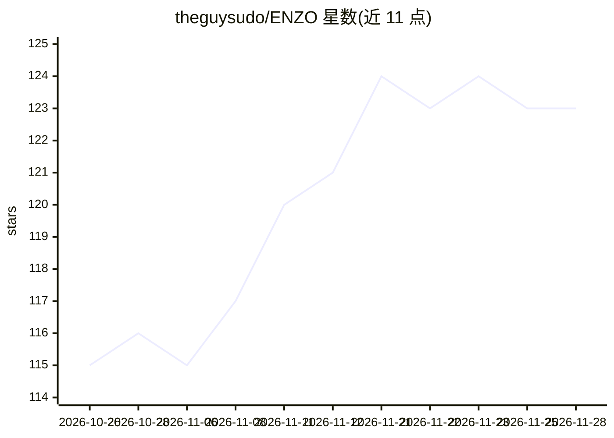

# theguysudo/ENZO

⭐ 123 · TypeScript · Apache-2.0 · 推送 2026-11-27 · [GitHub](https://github.com/theguysudo/ENZO) · [官网](https://enzo-hub.duckdns.org) · 个人维护

**自托管 AI 工作台：用自己的 API key 聊天、建 Agent、做调查**

ENZO 是一个自托管的 AI 工作空间，用户以 BYOK 方式接入自有 provider API key（Groq、OpenRouter、NVIDIA、Hugging Face、Google AI 等），无账号、无订阅、无中间抽成。功能包括：跨 9 个 provider 的 300+ 模型统一目录、75 个可注入 agent 技能、两阶段自起草 agent 构建器、带证据引文的调查工作空间（plan→discover→extract→verify→report 流水线）、记录用户偏好的 Neural Engine 私有层。提供桌面应用（macOS .dmg / Windows .exe）与 Docker 部署两种方式，Apache-2.0 许可。

## 筛选速览

| 维度 | 判定 | 备注 |
|---|---|---|
| AI 角色 | `ai-native` | 本体是模型或模型工具 |
| 许可风险 | `permissive` | Apache-2.0 |
| 部署形态 | `desktop` | 安装包/桌面程序 |
| 模型依赖 | locked-api |  |
| 硬件要求 | — | 无带数字的原话,不猜 |
| 安装摩擦 | `low` | 无编译、无系统依赖或容器化 |
| 成熟度 | — | 结构信号不足 |

## 能力要点

- BYOK 模式：请求直达所选 provider，无 ENZO 账号与订阅
- 调查工作空间：每条结论附带机器校验的原文引文
- 75 个 agent 技能与两阶段自起草 agent 构建器
- 提供 macOS/Windows 一键桌面应用，无需 Docker

## 适用场景

- 在自有基础设施上用多个 provider 的 key 聊天和跑 agent
- 对指定目标做带证据引文的调查并输出 markdown 报告
- homelab 场景自托管一个 ChatGPT 类聊天界面

## 场景标签

`聊天机器人` `AI 助手` · 领域:对话与助手

## 证据(README 行号)

> L45: > **Chat with 300+ models. Build agents that write their own operating manuals. Research, generate code, run it all
> L114: |Models in one catalog|300+|across 9 providers, health-checked live|
> L125: ## Quickstart

## 星数曲线

2026-10-26 115 → 2026-11-28 123（+8）

---
*卡片 v1 · prompt 1.4 · 生成 2026-11-28 · 置信度 high · 依据 README sha `089e069fb603` · [字段定义](../../DATASET.md)*
