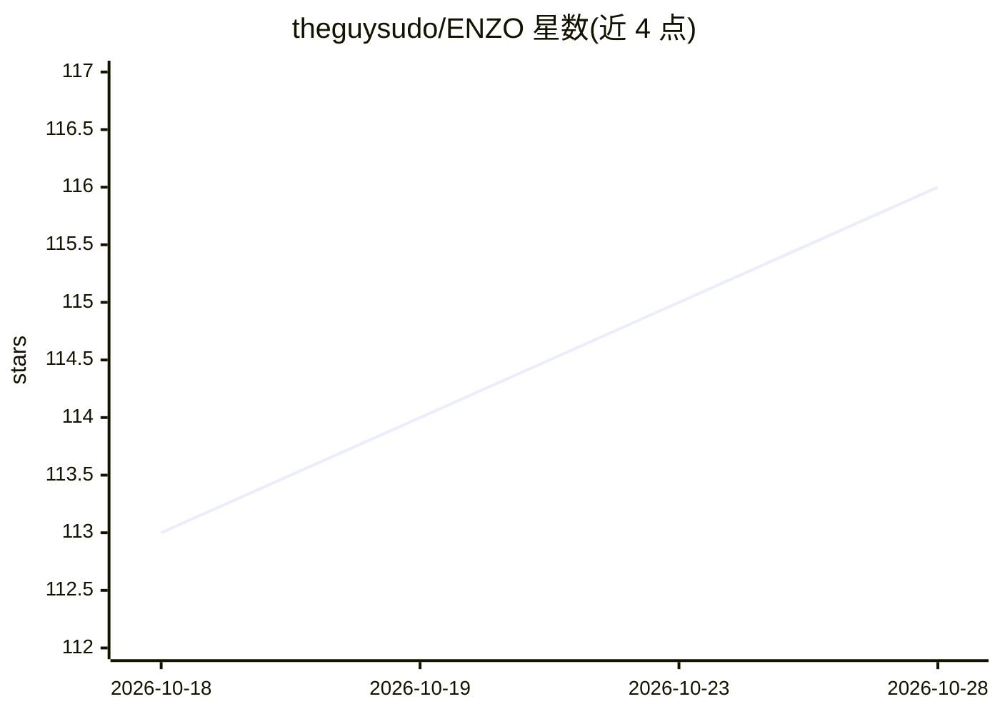

# theguysudo/ENZO

⭐ 116 · TypeScript · Apache-2.0 · 推送 2026-10-28 · [GitHub](https://github.com/theguysudo/ENZO) · [官网](https://enzo-hub.duckdns.org) · 个人维护

**BYOK 自托管 AI 工作台：多模型聊天、自拟手册的 agent 与代码生成**

自托管 AI 工作区（TypeScript，MIT），通过 BYOK 方式接入 OpenRouter、Groq、Google AI、NVIDIA、Hugging Face 等 9 家供应商，密钥以 AES-256-GCM 加密封存在浏览器 Vault 中。功能面包括 300+ 模型统一目录的流式聊天、用自然语言描述任务后两遍草拟运行手册的 agent 构建器、深度研究模式、代码生成与沙箱化后端启动。部署方式为 docker compose 一条命令或 Google Colab 笔记本。自托管模式下首个有效密钥会认领实例并写入容器 .env（文档中明示此取舍）。

## 筛选速览

| 维度 | 判定 | 备注 |
|---|---|---|
| AI 角色 | `ai-native` | 本体是模型或模型工具 |
| 许可风险 | `permissive` | Apache-2.0 |
| 部署形态 | `self-host` | docker 或自建部署 |
| 模型依赖 | locked-api |  |
| 硬件要求 | — | 无带数字的原话,不猜 |
| 安装摩擦 | `low` | 无编译、无系统依赖或容器化 |
| 成熟度 | — | 结构信号不足 |

## 能力要点

- 9 家供应商 300+ 模型统一目录，BYOK 直连无中间层
- agent 构建器：两遍草拟运行手册，多免费模型竞速起草
- 密钥 AES-256-GCM 浏览器封存，CI 每次 push 跑 44 项黑盒渗透测试
- docker compose 单容器零配置安装，另提供 Colab 零安装运行

## 适用场景

- 自托管一个多供应商模型聊天与 agent 工作区
- 用自然语言描述任务让系统起草可运行的 agent 手册
- 在自有基础设施上用各家 API key 跑研究与代码生成

## 场景标签

`聊天机器人` `代码生成` `科研工具` · 领域:编码与开发

## 证据(README 行号)

> L39: > **Chat with 300+ models. Build agents that write their own operating manuals. Research, generate code, run it all
> L110: |**Terminal**|Streaming chat with 300+ models — normal, thinking, research and coding modes — with a live ECG-styl
> L113: |**Agent builder**|Describe a task in plain English; ENZO drafts the agent's full operating manual, and the agent 

## 星数曲线

2026-10-18 113 → 2026-10-28 116（+3）

---
*卡片 v1 · prompt 1.4 · 生成 2026-10-23 · 置信度 high · 依据 README sha `bda7713c2f6b` · [字段定义](../../DATASET.md)*
