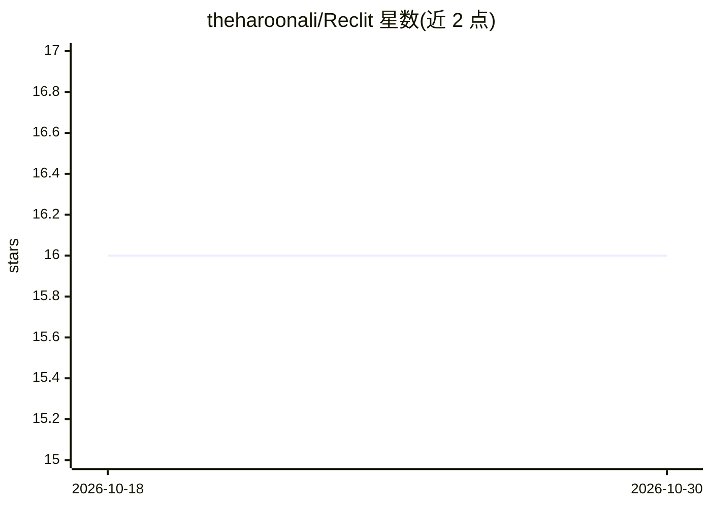

# theharoonali/Reclit

⭐ 16 · TypeScript · 推送 2026-10-29 · [GitHub](https://github.com/theharoonali/Reclit) · [官网](https://reclit.com) · 个人维护

**面向开发者自建的 Canvas 电子表格全栈基础设施**

开源电子表格基础设施：前端用 Canvas 绘制网格，支持百万级虚拟行、类型化列与原位编辑，无 DOM 表格；后端为 NestJS + tRPC + Prisma + PostgreSQL 的电子表格 API，提供稀疏行、防抖写入、CSV/XLSX 导入与公共表单。仓库以 AGENTS.md、.claude/skills、契约测试和路由文档为 AI 编程代理提供操作指引。供开发者用 Bun 从源码运行并二次开发。

## 筛选速览

| 维度 | 判定 | 备注 |
|---|---|---|
| AI 角色 | `ai-enhanced` | 去掉 AI 部分产品仍成立 |
| 许可风险 | `none` | — |
| 部署形态 | `None` |  |
| 模型依赖 | — | README 未给出锁定关系 |
| 硬件要求 | — | 无带数字的原话,不猜 |
| 安装摩擦 | `low` | 无编译、无系统依赖或容器化 |
| 成熟度 | — | 结构信号不足 |

## 能力要点

- Canvas 渲染网格：百万级虚拟行、DPR 校正绘制、原位编辑
- 9 种类型化列（含 FORMULA/AUDIO/FILE）与防抖写入的后端 API
- AGENTS.md 与 .claude/skills 指引 AI 编程代理开发功能
- 每个 API 由契约测试文档化，每条路由有对应文档

## 适用场景

- 自建可定制的数据表格/电子表格产品
- 通过公共表单向表格收集数据行
- 作为 AI 编程代理可协作开发的全栈项目模板

## 场景标签

 · 领域:开发者工具/数据表格应用

## 证据(README 行号)

> L3: Best spreadsheet infrastructure out there.
> L9: The repo is AI-friendly: AGENTS.md maps the layout, commands, and
> L10: hard invariants; skills under `.claude/skills/` walk agents through a feature;

## 星数曲线

2026-10-18 16 → 2026-10-30 16（+0）

---
*卡片 v1 · prompt 1.4 · 生成 2026-10-30 · 置信度 mid · 依据 README sha `710b52c78118` · [字段定义](../../DATASET.md)*
