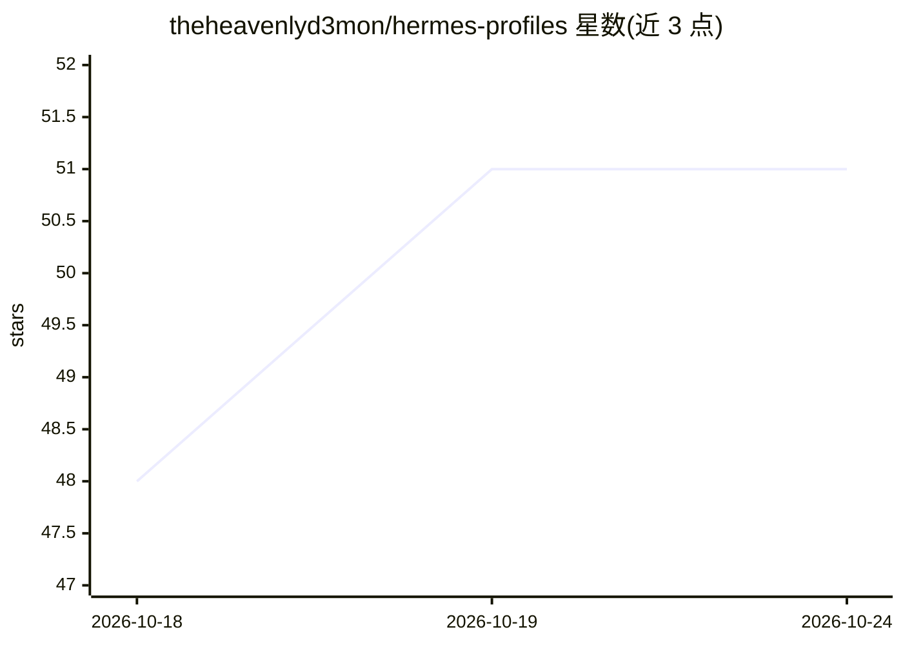

# theheavenlyd3mon/hermes-profiles

⭐ 51 · Python · 推送 2026-08-13 · [GitHub](https://github.com/theheavenlyd3mon/hermes-profiles) · 个人维护

**Hermes Agent 的角色配置集合：编排/编码/科研等专用 agent 人格**

为 Hermes Agent 框架提供的一组可复用 profile：每个 profile 含 SOUL.md（身份、方法论、输出标准）与领域 skills 目录，覆盖顶层编排者 senna、code/creative/research/security/infra/mlops 等编排角色和 finance、cyber-blue-* 等 worker 角色。支持多 agent 舰队模式：senna 解析意图并路由到对应专家。通过 hermes CLI 创建 profile、复制文件或从 skill registry 安装技能，config.yaml 中自选模型（deepseek-chat、claude-sonnet-4、gpt-4o 等）。含第三方 Anthropic 网络安全技能（753 条，Apache 2.0）。

## 筛选速览

| 维度 | 判定 | 备注 |
|---|---|---|
| AI 角色 | `ai-ecosystem` | LLM/agent 周边工具 |
| 许可风险 | `none` | — |
| 部署形态 | `None` |  |
| 模型依赖 | — | README 未给出锁定关系 |
| 硬件要求 | — | 无带数字的原话,不猜 |
| 安装摩擦 | `low` | 无编译、无系统依赖或容器化 |
| 成熟度 | — | 结构信号不足 |

## 能力要点

- 每个 profile 含 SOUL.md 与 skills/，可编辑 PersRubric 人格分数（0-100）
- 多 agent 舰队：senna 顶层编排，按域路由到专家 profile
- 支持 hermes skill install 从技能注册表安装单项技能
- 收录 753 条第三方网络安全技能用于 cyber 系列角色

## 适用场景

- 为 Hermes Agent 快速搭建编排者+专家的多角色舰队
- 复用现成人格与技能配置定制个人 agent
- 了解 agent 角色分工与路由的组织方式

## 场景标签

`多智能体` `提示工程` · 领域:Agent 开发

## 证据(README 行号)

> L3: A curated set of Hermes Agent profiles — specialized AI agents with distinct personalities, methodologies, and skill
> L27: hermes profile create <profile-name>

## 星数曲线

2026-10-18 48 → 2026-10-24 51（+3）

---
*卡片 v1 · prompt 1.4 · 生成 2026-10-24 · 置信度 high · 依据 README sha `1eb005ed69db` · [字段定义](../../DATASET.md)*
