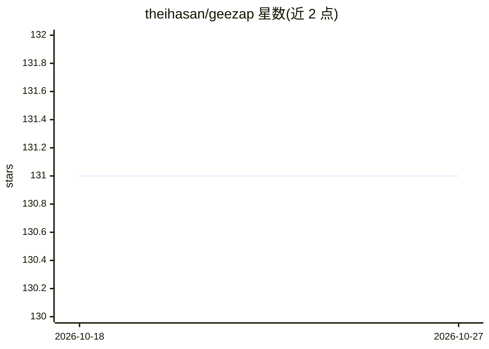

# theihasan/geezap

⭐ 131 · PHP · 推送 2026-03-17 · [GitHub](https://github.com/theihasan/geezap) · [官网](http://geezap.com) · 个人维护

**Laravel 职位聚合平台：统一搜索多平台职位并带 AI 求职信生成**

基于 Laravel/Livewire/MySQL 的职位聚合 Web 应用，将 LinkedIn、Upwork、Indeed、ZipRecruiter 的职位整合到统一搜索界面，功能包括智能职位匹配、AI 自动生成求职信与申请跟踪。搜索通过 Typesense 服务器实现浏览器直连，并使用带 24 小时 TTL 的受限 API key 轮换机制；需配置 OpenAI 或其他 AI 服务密钥、Cloudflare Turnstile、Redis、Typesense 等多个外部服务与后台进程方可运行。

## 筛选速览

| 维度 | 判定 | 备注 |
|---|---|---|
| AI 角色 | `ai-enhanced` | 去掉 AI 部分产品仍成立 |
| 许可风险 | `none` | — |
| 部署形态 | `self-host` | docker 或自建部署 |
| 模型依赖 | — | README 未给出锁定关系 |
| 硬件要求 | — | 无带数字的原话,不猜 |
| 安装摩擦 | `low` | 无编译、无系统依赖或容器化 |
| 成熟度 | — | 结构信号不足 |

## 能力要点

- 聚合 LinkedIn/Upwork/Indeed/ZipRecruiter 职位到统一搜索界面
- AI 求职信生成与申请跟踪功能
- Typesense 浏览器直连搜索，受限 key 自动轮换（24 小时 TTL）
- Cloudflare Turnstile 人机验证与 Redis/Reverb 后台服务

## 适用场景

- 在单一界面搜索多个招聘平台的职位
- 借助 AI 为申请自动生成求职信
- 跟踪自己的求职申请进度

## 场景标签

`AI 写作` · 领域:内容生成

## 证据(README 行号)

> L3: A comprehensive job aggregation platform that consolidates job listings from multiple sources (LinkedIn, Upwork, Ind
> L385: **Solution**: Verify AI service API key is set correctly in `.env`

## 星数曲线

2026-10-18 131 → 2026-10-27 131（+0）

---
*卡片 v1 · prompt 1.4 · 生成 2026-10-22 · 置信度 mid · 依据 README sha `b85e94f4169c` · [字段定义](../../DATASET.md)*
