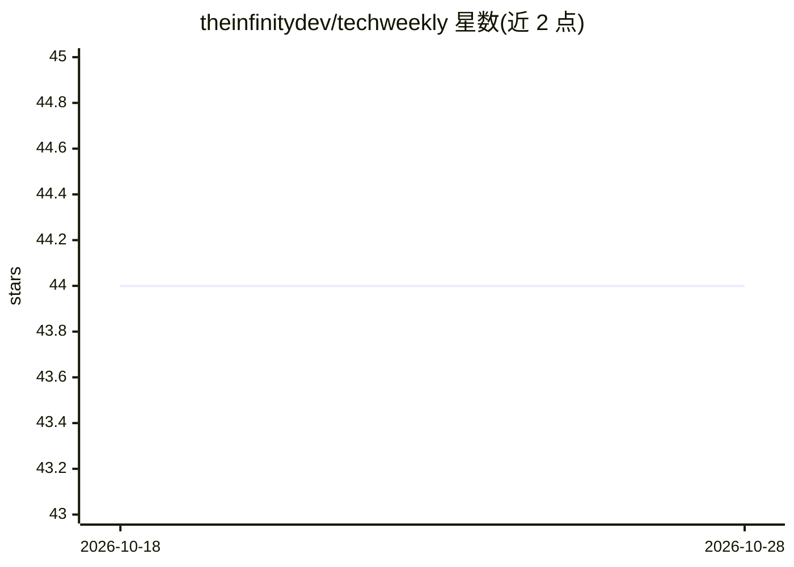

# theinfinitydev/techweekly

⭐ 44 · 推送 2026-01-05 · [GitHub](https://github.com/theinfinitydev/techweekly) · [官网](https://www.theinfinity.dev/) · 组织维护

**技术资源周更清单：软件开发、DevOps 与 AI 工具/文章策展**

由 The Infinity 每周发布的技术资源精选集合，按类别组织条目表格：开发工具与平台、DevOps 与基础设施、AI 与机器学习、应用与实用工具、学习资源、技术文章等。条目以仓库名/站点加描述、星标与标签的形式列出，含 LocalAI、Langflow、DB-GPT 等 AI 项目及系统设计类文章。资源每周更新，用户通过 Star 与关注仓库跟踪更新；不含本产品自身的安装与运行方式。

## 筛选速览

| 维度 | 判定 | 备注 |
|---|---|---|
| AI 角色 | `ai-knowledge` | 知识聚合/清单类 |
| 许可风险 | `none` | — |
| 部署形态 | `self-host` | docker 或自建部署 |
| 模型依赖 | — | README 未给出锁定关系 |
| 硬件要求 | — | 无带数字的原话,不猜 |
| 安装摩擦 | `low` | 无编译、无系统依赖或容器化 |
| 成熟度 | — | 结构信号不足 |

## 能力要点

- 按 6+ 个类别组织的条目表格，含描述与标签
- 每周更新工具、库与文章
- AI/ML 类别收录 20+ 个项目条目

## 适用场景

- 每周发现新的开发、DevOps 与 AI 工具
- 查找系统设计与架构类技术文章
- 浏览开源项目与学习资源清单

## 场景标签

`精选清单` · 领域:学习与行业

## 证据(README 行号)

> L3: This repository is a curated collection of technology resources published weekly by The Infinity. It includes the la
> L70: ## 🧠 AI & Machine Learning

## 星数曲线

2026-10-18 44 → 2026-10-28 44（+0）

---
*卡片 v1 · prompt 1.4 · 生成 2026-10-25 · 置信度 mid · 依据 README sha `f0de7c0fa57e` · [字段定义](../../DATASET.md)*
