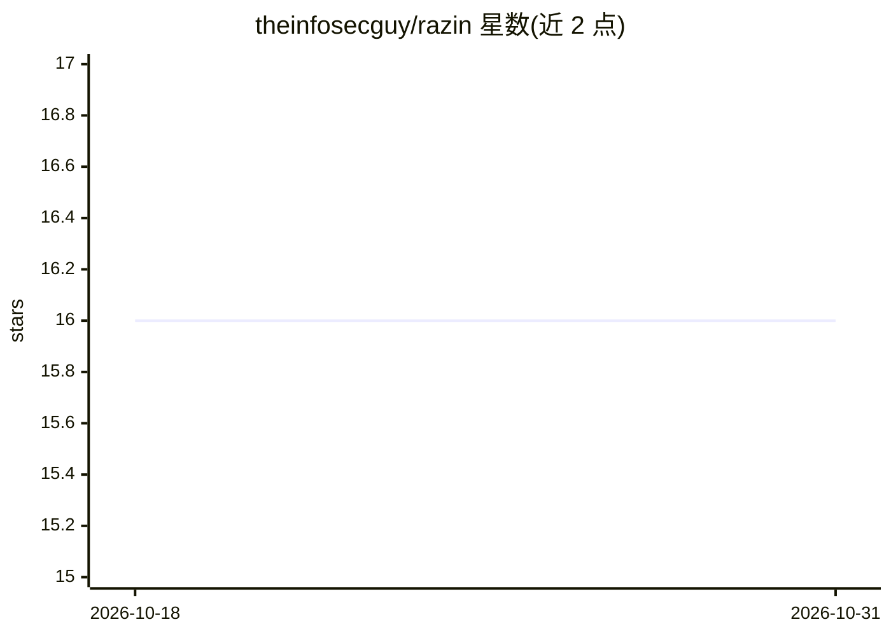

# theinfosecguy/razin

⭐ 16 · Python · MIT · 推送 2026-10-24 · [GitHub](https://github.com/theinfosecguy/razin) · [官网](https://theinfosecguy.github.io/razin/) · 个人维护

**SKILL.md 智能体技能的本地静态安全扫描器**

面向使用 SKILL.md 定义 LLM agent 技能的开发者，提供仅静态分析（不执行代码）的本地扫描器，输出确定性安全发现。支持可选的沙箱工件工作流：封装需审批的计划并模拟验证，同样不运行技能代码。通过 Homebrew tap 或 PyPI 安装，提供 scan、validate-config 等 CLI 命令，可按严重级别或评分设置 CI 门禁，导出 JSON/CSV/SARIF 格式报告。限制：仅做静态分析，沙箱流程为模拟验证而非真实执行。

## 筛选速览

| 维度 | 判定 | 备注 |
|---|---|---|
| AI 角色 | `ai-ecosystem` | LLM/agent 周边工具 |
| 许可风险 | `permissive` | MIT |
| 部署形态 | `library` | 以包/库形式分发 |
| 模型依赖 | — | README 未给出锁定关系 |
| 硬件要求 | — | 无带数字的原话,不猜 |
| 安装摩擦 | `low` | 无编译、无系统依赖或容器化 |
| 成熟度 | — | 结构信号不足 |

## 能力要点

- 仅静态分析，不执行技能代码，输出确定性发现
- 可选沙箱工件工作流：封装审批计划并模拟验证
- CI 门禁：按 high 严重级别或评分阈值失败
- JSON/CSV/SARIF 多种报告输出格式

## 适用场景

- 在 CI 中拦截含高危发现的 agent 技能
- 审计 SKILL.md 技能文件的安全问题
- 生成 SARIF 报告接入代码扫描平台

## 场景标签

`网络安全` · 领域:学习与行业

## 证据(README 行号)

> L1: Razin - Static analysis for LLM agent skills
> L5: Razin is a local scanner for `SKILL.md`-defined agent skills.
> L6: It performs static analysis only (no execution) and writes deterministic findings.

## 星数曲线

2026-10-18 16 → 2026-10-31 16（+0）

---
*卡片 v1 · prompt 1.4 · 生成 2026-10-30 · 置信度 high · 依据 README sha `dd362d18a3c3` · [字段定义](../../DATASET.md)*
