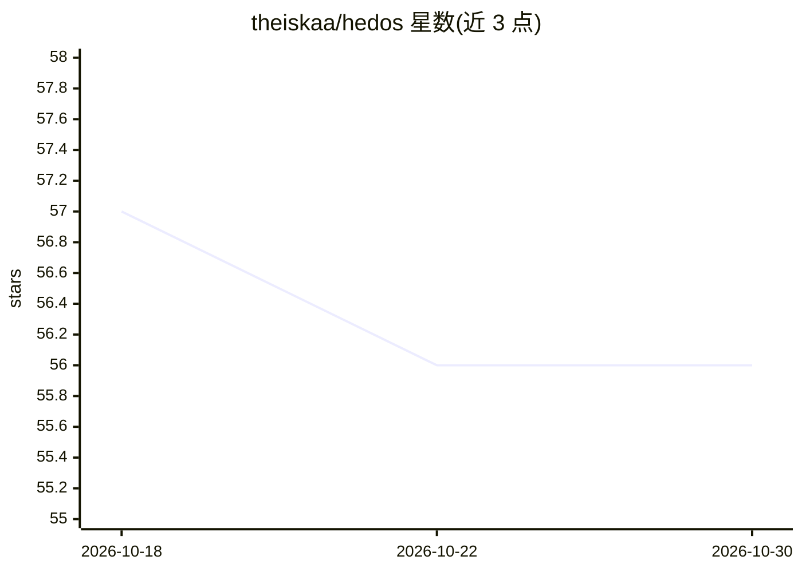

# theiskaa/hedos

⭐ 56 · Rust · MIT · 推送 2026-10-24 · [GitHub](https://github.com/theiskaa/hedos) · [官网](https://hedos.ai) · 个人维护

**本地模型的统一发现、安装与无头服务引擎（单二进制+HTTP 网关）**

hedos 是一个 Rust 编写的单二进制引擎，扫描本机已有的模型存储（Ollama store、Hugging Face 缓存、LM Studio 库、散落的 GGUF/safetensors 文件）并集中列管，为每个模型匹配合适的运行时（llama-server、Ollama、OpenAI 兼容端点、Python sidecar、Apple Intelligence 等）。内置绑定回环地址的 OpenAI/Ollama/Anthropic 兼容 HTTP 网关，编辑器、脚本或 agent 可直接接入；支持拉取新模型（写入各平台原生存储）、TUI 界面、启动 Claude Code/Aider 等 coding harness。限制：网关不要求 token 且仅限 loopback；部分运行时需自装 uv/llama-server/Ollama；Apple Intelligence 桥接库仅源码构建可得。面向在本地管理多来源模型的开发者。

## 筛选速览

| 维度 | 判定 | 备注 |
|---|---|---|
| AI 角色 | `ai-ecosystem` | LLM/agent 周边工具 |
| 许可风险 | `permissive` | MIT |
| 部署形态 | `library` | 以包/库形式分发 |
| 模型依赖 | local-ok | 支持本地模型 |
| 硬件要求 | — | 无带数字的原话,不猜 |
| 安装摩擦 | `medium` | 含编译或系统依赖之一 |
| 成熟度 | — | 结构信号不足 |

## 能力要点

- 扫描多来源模型存储并统一列管，不移动权重文件
- 单二进制内嵌 OpenAI/Ollama/Anthropic 兼容的本地 HTTP 网关（127.0.0.1:43367）
- 按模型自动匹配运行时并展示上下文长度、chat 模板、工具调用能力
- hedos launch 免配置对接 Claude Code、OpenCode、Aider、Goose、Crush

## 适用场景

- 把散落在 Ollama/HF 缓存/LM Studio 的本地模型集中到一个入口管理
- 让本机任意编辑器或脚本通过统一网关访问本地模型
- 为本地模型一键拉起 coding harness 做代码工作

## 场景标签

`推理引擎` `模型网关` · 领域:Agent 开发

## 证据(README 行号)

> L11: hedos is a headless engine for the local models already on your machine. It finds them wherever they live, installs
> L15: Each model is resolved to the runtime that serves it: llama-server, Ollama, an OpenAI-compatible endpoint, or a man
> L113: ## The gateway

## 星数曲线

2026-10-18 57 → 2026-10-30 56（-1）

---
*卡片 v1 · prompt 1.4 · 生成 2026-10-24 · 置信度 high · 依据 README sha `85a5e698060d` · [字段定义](../../DATASET.md)*
