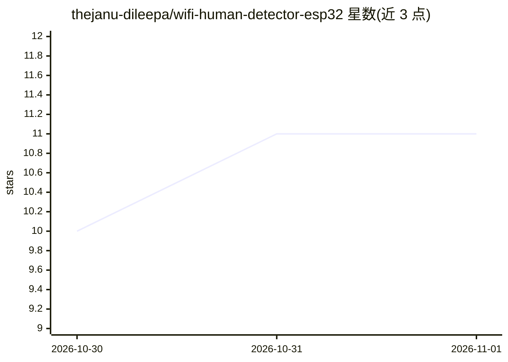

# thejanu-dileepa/wifi-human-detector-esp32

⭐ 11 · Python · 推送 2026-10-04 · [GitHub](https://github.com/thejanu-dileepa/wifi-human-detector-esp32) · 个人维护

**用 Wi-Fi CSI 在 ESP32-S3 上做人体存在与活动检测的开源项目**

由 ESP32-S3 固件与 PC 端 Python 工具组成的 Wi-Fi 感知系统：设备端基于子载波幅度方差 z-score 做存在/占用检测（约 30 秒环境校准，<1 秒延迟）；PC 端用 Random Forest 对 30 样本 RSSI 窗口做活动分类；另以 JSON over UDP（端口 5006）流式输出原始 CSI（I/Q 与幅度），并提供实验性的呼吸/心率估计脚本（未经验证）。面向硬件与嵌入式 AI 开发者，需 PlatformIO 烧录、串口配置 Wi-Fi 与 sink IP。限制：单节点空间分辨率有限，ML 分类器目前仅用 RSSI，生命体征为实验性且非医疗设备。

## 筛选速览

| 维度 | 判定 | 备注 |
|---|---|---|
| AI 角色 | `ai-native` | 本体是模型或模型工具 |
| 许可风险 | `none` | — |
| 部署形态 | `library` | 以包/库形式分发 |
| 模型依赖 | — | README 未给出锁定关系 |
| 硬件要求 | — | 无带数字的原话,不猜 |
| 安装摩擦 | `low` | 无编译、无系统依赖或容器化 |
| 成熟度 | `idea` | |

## 能力要点

- 设备端子载波幅度方差 z-score 存在检测，<1 秒延迟
- Random Forest 对 RSSI 窗口做活动分类，可自定义标签
- 全子载波 I/Q + 幅度以 JSON over UDP :5006 流式输出，可自写 sink
- 实验性呼吸/心率周期图估计（0.1–0.5 Hz / 0.8–2.0 Hz）

## 适用场景

- 无摄像头、无穿戴设备地感知房间是否有人及活动状态
- 采集并标注自己的 Wi-Fi CSI 数据训练活动分类器
- 把原始 CSI 流接入自研脚本做进一步处理

## 场景标签

 · 领域:嵌入式感知/物联网

## 证据(README 行号)

> L13: |👤|**Presence / occupancy**|Subcarrier-amplitude variance z-score with ~30 s ambient calibration, on-device|`PRESEN
> L14: |🚶|**Activity recognition**|Random Forest classifier over 30-sample RSSI windows (PC-side ML)|`Empty_Room`, `Human_

## 星数曲线

2026-10-30 10 → 2026-11-01 11（+1）

---
*卡片 v1 · prompt 1.4 · 生成 2026-11-01 · 置信度 mid · 依据 README sha `49288e30d371` · [字段定义](../../DATASET.md)*
