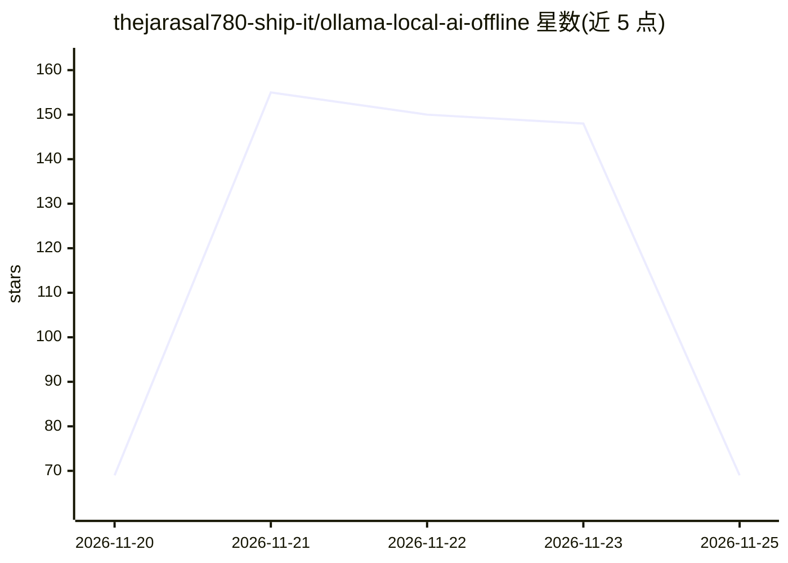

# thejarasal780-ship-it/ollama-local-ai-offline

⭐ 69 · Python · 推送 2026-11-23 · [GitHub](https://github.com/thejarasal780-ship-it/ollama-local-ai-offline) · 个人维护

**面向工程与研究人员的本地离线 LLM 桌面客户端**

自称提供完全自包含运行时的桌面应用，在本地硬件上执行大语言模型，管理模型检索、量化加载与推理调度，支持本地模型库、多模型并发服务、GGUF 格式、OpenAI 兼容的本地 HTTP API、流式输出与资源限额。界面模块含聊天工作区、提示词库、会话历史与生成参数预设。注意：需求一节列有 Active network connection，与离线表述并存。

## 筛选速览

| 维度 | 判定 | 备注 |
|---|---|---|
| AI 角色 | `ai-ecosystem` | LLM/agent 周边工具 |
| 许可风险 | `none` | — |
| 部署形态 | `None` |  |
| 模型依赖 | — | README 未给出锁定关系 |
| 硬件要求 | — | 无带数字的原话,不猜 |
| 安装摩擦 | `medium` | 含编译或系统依赖之一 |
| 成熟度 | — | 结构信号不足 |

## 能力要点

- 完全离线推理：计算、存储与模型状态留在本机，无遥测与外发请求
- OpenAI 兼容的本地 HTTP API 端点，可接入现有客户端库
- 多模型并发服务，按请求选择模型并配置资源分配
- 本地模型库、提示词库、会话历史与生成预设四大模块

## 适用场景

- 飞机上无网络时对机密笔记做摘要与提问
- 为每周客户例会用可复用提示词与预设生成一致的摘要
- 在多个本地模型之间对比同一任务的回复并管理会话记录

## 场景标签

`推理引擎` `模型量化` `提示工程` `知识库管理` · 领域:Agent 开发

## 证据(README 行号)

> L12: Ollama Local AI Offline is a desktop application that provides a fully self-contained runtime for executing large l
> L27: - **OpenAI-compatible API surface**: Exposes a local HTTP endpoint compatible with common chat and completion reque
> L44: 2. **Runtime initialization** — A background service binds to a local loopback interface and exposes an inference A

## 星数曲线

2026-11-20 69 → 2026-11-25 69（+0）

---
*卡片 v1 · prompt 1.4 · 生成 2026-11-20 · 置信度 mid · 依据 README sha `3b82699f9c67` · [字段定义](../../DATASET.md)*
