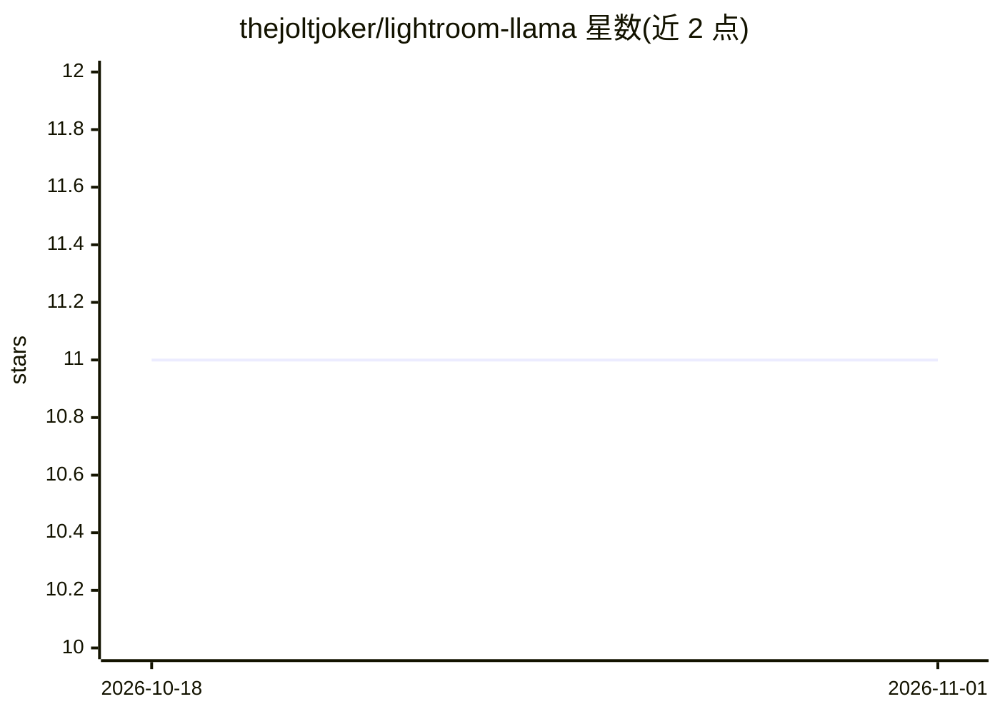

# thejoltjoker/lightroom-llama

⭐ 11 · Lua · MIT · 推送 2026-04-22 · [GitHub](https://github.com/thejoltjoker/lightroom-llama) · [官网](https://thejoltjoker.github.io/lightroom-llama/) · 个人维护

**Lightroom 插件：用本地 Ollama 为照片生成元数据**

Adobe Lightroom Classic 的 Lua 插件，调用本地运行的 Ollama 为照片生成标题与说明等元数据，面向摄影与图库素材用户。生成在本地完成，不联网、照片不上传。使用前需安装 Adobe Lightroom Classic、Ollama 及其已下载的模型（如 Llama 2 或 minicpm-v），插件通过 Plug-in Manager 加载 .lrplugin 文件安装。TODO 显示尚待支持更多模型、批量处理与自定义提示模板。MIT 许可。

## 筛选速览

| 维度 | 判定 | 备注 |
|---|---|---|
| AI 角色 | `ai-native` | 本体是模型或模型工具 |
| 许可风险 | `permissive` | MIT |
| 部署形态 | `None` |  |
| 模型依赖 | local-ok | 支持本地模型 |
| 硬件要求 | — | 无带数字的原话,不猜 |
| 安装摩擦 | `low` | 无编译、无系统依赖或容器化 |
| 成熟度 | — | 结构信号不足 |

## 能力要点

- 在 Lightroom 内调用 Ollama 生成照片标题与说明
- 本地生成，无需联网，照片不上传
- 通过 Plug-in Manager 以 .lrplugin 形式安装

## 适用场景

- 为图库照片批量构思标题和说明文字
- 在本地离线环境下为照片生成元数据
- 在 Lightroom 工作流中直接调用本地 LLM

## 场景标签

`AI 写作` · 领域:内容生成

## 证据(README 行号)

> L3:  Generate metadata for your photos with ollama, directly in Lightroom
> L13: - Generate metadata for your photos with ollama, directly in Lightroom

## 星数曲线

2026-10-18 11 → 2026-11-01 11（+0）

---
*卡片 v1 · prompt 1.4 · 生成 2026-11-01 · 置信度 high · 依据 README sha `a6e2fb20793e` · [字段定义](../../DATASET.md)*
