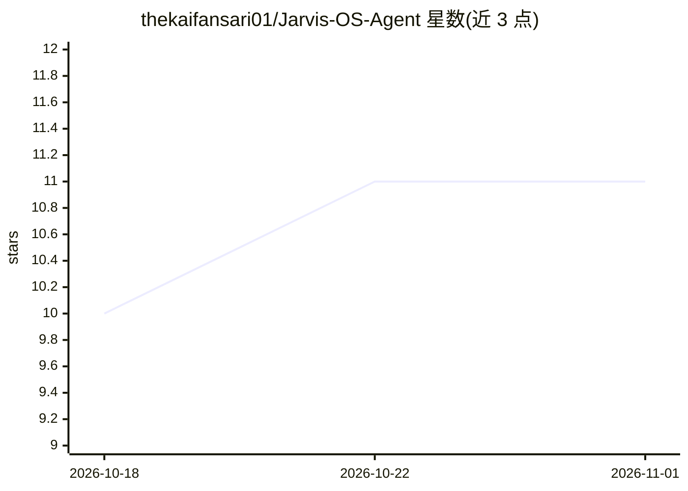

# thekaifansari01/Jarvis-OS-Agent

⭐ 11 · Python · GPL-3.0 · 推送 2026-10-29 · [GitHub](https://github.com/thekaifansari01/Jarvis-OS-Agent) · [官网](https://jarvis-os-agent.vercel.app/) · 个人维护

**Windows 开源自主 AI 助理：语音控制 PC、安卓与通讯应用**

面向个人用户的 Windows 自主 AI 助理项目，以语音或快捷键输入驱动 Agent 循环：可操作文件系统、终端、GUI 键鼠，接入 Gmail、WhatsApp、Telegram、Google Calendar，并通过 Termux/ADB/SSH 控制 Android 设备。机制上提供语义路由（多级回退）、执行中途语音纠正（可变计划图）、终身情景记忆与 Hybrid RAG（Chroma）、双引擎语音与唤醒词、主动事件拦截并请求人工确认（HITL）。README 以三段未剪辑控制台日志作为运行证明，演示在 2012 年 i5/4GB 内存笔记本上完成。Python 编写，GPL v3 许可。

## 筛选速览

| 维度 | 判定 | 备注 |
|---|---|---|
| AI 角色 | `ai-native` | 本体是模型或模型工具 |
| 许可风险 | `dual` | GPL-3.0 |
| 部署形态 | `desktop` | 安装包/桌面程序 |
| 模型依赖 | local-ok | 支持本地模型 |
| 硬件要求 | — | 无带数字的原话,不猜 |
| 安装摩擦 | `low` | 无编译、无系统依赖或容器化 |
| 成熟度 | — | 结构信号不足 |

## 能力要点

- 执行中途可注入语音纠正，无需重启 Agent 循环
- 语义路由带 3 级回退（云端→本地规则→FAST）
- 终身情景记忆 + Chroma Hybrid RAG 并行索引
- Android Termux 桥与 Telegram 远程控制

## 适用场景

- 用语音命令让 Agent 自主写代码、跑测试并自修复
- 让助理代发邮件、管理日历、回复 WhatsApp/Telegram
- 远程操控安卓手机并与 PC 形成同一记忆体

## 场景标签

`AI 助手` `语音 Agent` `GUI 自动化` · 领域:效率与自动化

## 证据(README 行号)

> L3: > **An AI Operating System that autonomously controls your PC, Android phone, local files, and lifelong memory — not
> L5: > **Open-Source · Semantic Behavioral Pattern Engine · Live Mid-Execution Correction · Inline Comms Preview & Edit ·
> L240: 1. **It acts in the real world, not just in chat.** Gmail, WhatsApp, Telegram, Google Calendar, Termux on your And

## 星数曲线

2026-10-18 10 → 2026-11-01 11（+1）

---
*卡片 v1 · prompt 1.4 · 生成 2026-11-01 · 置信度 low · 依据 README sha `9fe02c206a04` · [字段定义](../../DATASET.md)*
