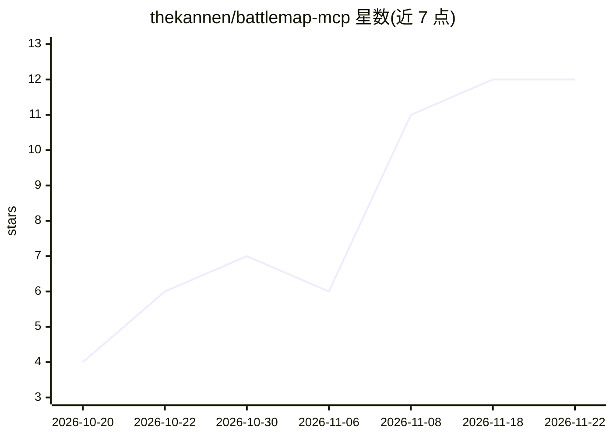

# thekannen/battlemap-mcp

⭐ 12 · Python · MIT · 推送 2026-11-15 · [GitHub](https://github.com/thekannen/battlemap-mcp) · [官网](https://knownframe.com/battlemap-mcp/) · 个人维护

**本地 MCP 桥：让 AI 助手用已有素材构建 Dungeondraft 战役地图**

本地运行的 MCP 服务器，连接 AI 助手（Claude Desktop、Claude Code、Codex、OpenCode 等 MCP 客户端）与用户已安装的 Dungeondraft 1.2.0.1，使助手能构建、检查和修改当前打开的地图。它不生成原创素材，只驱动用户已拥有的资产。可识别并配合 Unofficial Patch、Custom Snap、Soft Shadows、Sketch Tool 四个模组，支持从简报生成整张地图、摆放物件、导出/重建 Universal VTT 文件。提供 Windows/macOS/Linux 安装指南与 Claude 桌面扩展安装方式。

## 筛选速览

| 维度 | 判定 | 备注 |
|---|---|---|
| AI 角色 | `ai-ecosystem` | LLM/agent 周边工具 |
| 许可风险 | `permissive` | MIT |
| 部署形态 | `desktop` | 安装包/桌面程序 |
| 模型依赖 | — | README 未给出锁定关系 |
| 硬件要求 | — | 无带数字的原话,不猜 |
| 安装摩擦 | `low` | 无编译、无系统依赖或容器化 |
| 成熟度 | — | 结构信号不足 |

## 能力要点

- 本地 MCP 桥接，AI 助手可直接操作 Dungeondraft 中打开的地图
- 识别并配合 4 个社区模组（Unofficial Patch、Custom Snap、Soft Shadows、Sketch Tool）
- 支持从简报生成整张地图、 furnished 房间、导出 Universal VTT 文件
- 仅驱动用户已拥有的素材，不生成原创资产

## 适用场景

- 让 AI 助手根据一段简报自动搭建完整战役地图
- 在跑团准备中让助手完成重复性的物件摆放
- 将地图导出为 Universal VTT 供虚拟桌面使用

## 场景标签

`GUI 自动化` · 领域:效率与自动化

## 证据(README 行号)

> L3: An AI collaborator for your Dungeondraft maps: a local bridge that lets your AI assistant (Claude Desktop, Claude Co
> L13: This is a local automation layer for your own Dungeondraft map-making session. It does **not** generate original as
> L42: You need **Dungeondraft 1.2.0.1** and an AI app that can run local MCP servers, on the same computer. Follow **Get 

## 星数曲线

2026-10-20 4 → 2026-11-22 12（+8）

---
*卡片 v1 · prompt 1.4 · 生成 2026-11-18 · 置信度 high · 依据 README sha `175075a58bcd` · [字段定义](../../DATASET.md)*
