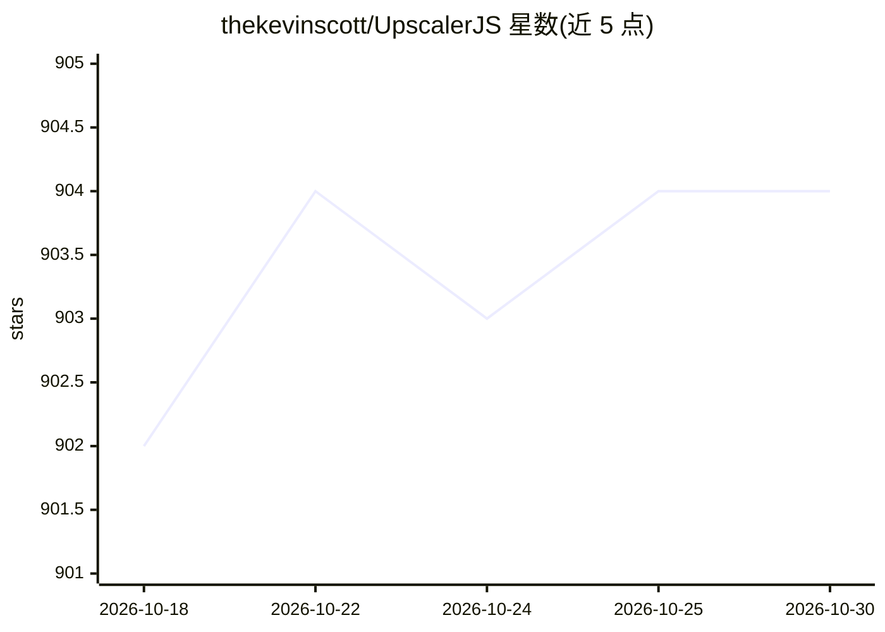

# thekevinscott/UpscalerJS

⭐ 904 · TypeScript · MIT · 推送 2026-10-29 · [GitHub](https://github.com/thekevinscott/UpscalerJS) · [官网](https://upscalerjs.com) · 个人维护

**JavaScript 图像超分辨率与增强库，浏览器/Node 均可用**

基于 TensorFlow.js 的图像增强 JavaScript 库，提供预训练模型用于提高分辨率、降噪、去模糊、修饰等操作，支持浏览器、Node（CPU/GPU）与 Workers 环境，MIT 许可。内置基于分块的补丁处理以支持 UI 场景下的性能，允许接入自定义预训练模型，附带 TypeScript 支持、文档与可运行示例。安装方式为 npm 包 upscaler，通过 import 后调用 upscale 方法输出 base64 图像。

## 筛选速览

| 维度 | 判定 | 备注 |
|---|---|---|
| AI 角色 | `ai-native` | 本体是模型或模型工具 |
| 许可风险 | `permissive` | MIT |
| 部署形态 | `None` |  |
| 模型依赖 | — | README 未给出锁定关系 |
| 硬件要求 | — | 无带数字的原话,不猜 |
| 安装摩擦 | `low` | 无编译、无系统依赖或容器化 |
| 成熟度 | — | 结构信号不足 |

## 能力要点

- 预训练模型覆盖超分辨率、降噪、去模糊等任务
- 支持浏览器、Node（CPU/GPU）与 Workers 运行环境
- 基于分块的补丁处理以支撑 UI 性能
- 可集成自定义预训练模型

## 适用场景

- 在网页前端直接对图片做超分辨率或降噪处理
- 在 Node 服务端批量增强图像
- 用自己的预训练模型定制增强效果

## 场景标签

`图像视频处理` · 领域:感知与多模态

## 证据(README 行号)

> L10: Enhance Images with Javascript and AI. Increase resolution, retouch, denoise, and more. Open Source, Browser & Node
> L12: - 🎁 **Pretrained Models:** Enhance images using UpscalerJS's diverse pretrained models, designed to suit various im

## 星数曲线

2026-10-18 902 → 2026-10-30 904（+2）

---
*卡片 v1 · prompt 1.4 · 生成 2026-10-21 · 置信度 high · 依据 README sha `3e3b29dfc7f6` · [字段定义](../../DATASET.md)*
