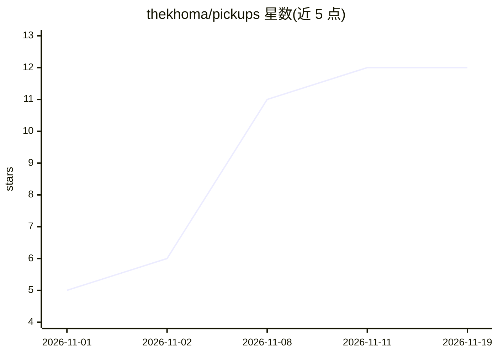

# thekhoma/pickups

⭐ 12 · Python · MIT · 推送 2026-10-30 · [GitHub](https://github.com/thekhoma/pickups) · 个人维护

**给视频创作者的本地 AI 视频编辑应用：去人、换人、改天气与补光**

构建在 ComfyUI 之上的开源视频应用，面向创作者与剪辑师。将片段导入后可执行人物移除（SAM 3.1 跟踪、背景从其他帧真实像素重建）、人物替换、天气与时间改动、整镜头重新打光、Blender previz 成片，以及 4K/HDR 交付（SeedVR2 放大、SDR 转 HDR）。渲染通过本机或网络上的 ComfyUI 在 NVIDIA GPU 上进行，每个结果作为新 take 记录谱系，导出 ProRes/MP4 与 FCP7 XML/EDL 回到剪辑软件。补光功能要求 24 GB 显存；部分模型在 Hugging Face 上有许可门槛。

## 筛选速览

| 维度 | 判定 | 备注 |
|---|---|---|
| AI 角色 | `ai-native` | 本体是模型或模型工具 |
| 许可风险 | `permissive` | MIT |
| 部署形态 | `desktop` | 安装包/桌面程序 |
| 模型依赖 | local-ok | 支持本地模型 |
| 硬件要求 | — | 无带数字的原话,不猜 |
| 安装摩擦 | `medium` | 含编译或系统依赖之一 |
| 成熟度 | — | 结构信号不足 |

## 能力要点

- 移除/换人/天气/打光/previz 成片/4K HDR 六类任务，全部经 ComfyUI 在本地 GPU 渲染
- 每个 take 报告 matte 外像素改动数并展示哪些像素来自原素材、他帧借用或生成
- 导出带源时间码的自描述文件名，FCP7 XML/CMX3600 EDL 可直接落回 Resolve/Premiere 时间线
- Prompt Director 可接 LM Studio 或 Ollama 本地 LLM 改写提示词

## 适用场景

- 从实拍镜头里去掉穿帮的收音杆、工作人员并重建背景
- 同一表演换角色卡上的演员，生成新 take 对比
- 把 Blender previz 转成带定妆照参考的成片镜头
- 给客户交付带收据（模型、许可、提示词、工作流）的 ProRes/MP4 成片

## 场景标签

`图像视频处理` · 领域:感知与多模态

## 证据(README 行号)

> L7: Pickups puts powerful open video models behind one simple app for creators and editors. Drop in a clip and remove wh
> L9: finish it to 4K HDR. It all runs on your own GPU through ComfyUI, and every result comes back as a new take you can
> L14: |**Remove**|Erase a person, boom, sign or crew member (and their shadow, and the bag they carry)|Click it. SAM 3.1 

## 星数曲线

2026-11-01 5 → 2026-11-19 12（+7）

---
*卡片 v1 · prompt 1.4 · 生成 2026-11-18 · 置信度 mid · 依据 README sha `52fed412b9f5` · [字段定义](../../DATASET.md)*
