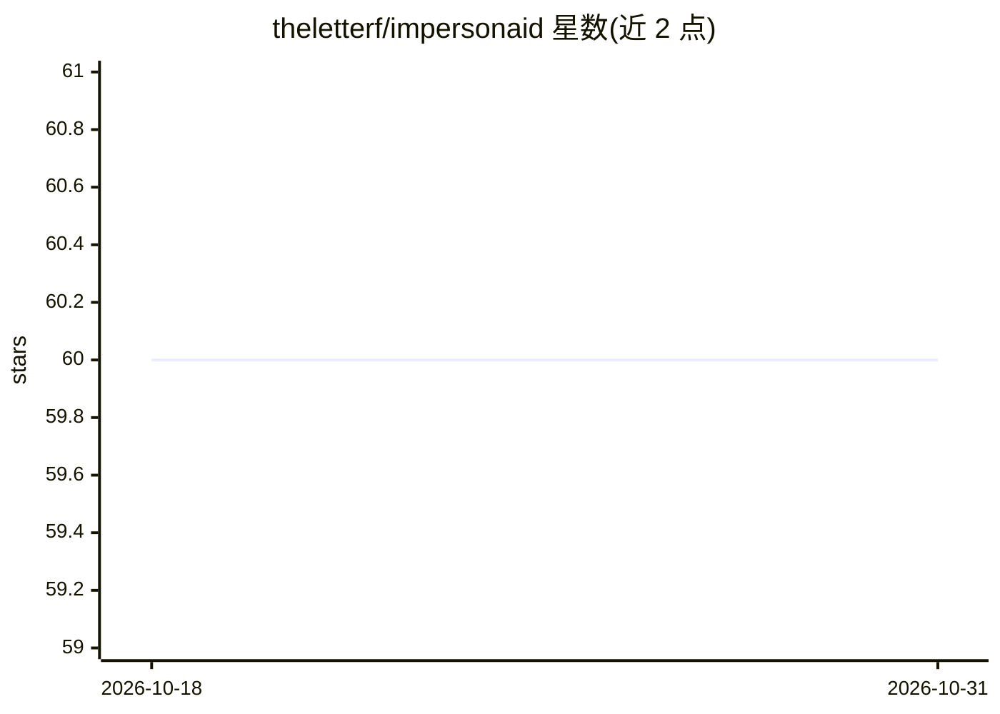

# theletterf/impersonaid

⭐ 60 · JavaScript · Apache-2.0 · 推送 2025-11-12 · [GitHub](https://github.com/theletterf/impersonaid) · [官网](https://passo.uno/) · 个人维护

**用 LLM 模拟用户画像来测试文档的可用性工具**

面向文档作者、UX 研究员与产品团队的文档评测工具：以 YAML 定义不同专业程度与背景的用户画像，通过 CLI 或本地 Web 界面对指定文档 URL 或粘贴的 Markdown 运行模拟会话，让 LLM 扮演该画像用户回答请求并生成反馈，结果保存为 Markdown。支持 OpenAI、Anthropic、Google、OpenRouter 及本地 Ollama 多种提供方；不支持网页浏览的模型由工具自行抓取并压缩文档内容注入提示。作者声明为实验性工具，不替代真实用户研究。

## 筛选速览

| 维度 | 判定 | 备注 |
|---|---|---|
| AI 角色 | `ai-native` | 本体是模型或模型工具 |
| 许可风险 | `permissive` | Apache-2.0 |
| 部署形态 | `None` |  |
| 模型依赖 | local-ok | 支持本地模型 |
| 硬件要求 | — | 无带数字的原话,不猜 |
| 安装摩擦 | `low` | 无编译、无系统依赖或容器化 |
| 成熟度 | `idea` | |

## 能力要点

- YAML 定义用户画像（专业程度/背景/偏好）
- CLI 与本地 Web 界面（localhost:3000）两种使用方式
- 多 LLM 提供方支持：OpenAI/Anthropic/Google/OpenRouter/Ollama
- 模拟结果保存为 Markdown 报告

## 适用场景

- 文档改版后快速获取不同画像用户的模拟反馈
- UX 团队在正式用户研究前做初步迭代验证
- 让初级/专家等不同背景的模拟用户试用入门文档

## 场景标签

 · 领域:开发者工具/文档与UX

## 证据(README 行号)

> L3: Impersonaid helps you evaluate your documentation against LLM-powered user personas to simulate real user interactio
> L9: Impersonaid is a tool that helps documentation writers, UX researchers, and product teams evaluate documentation fro

## 星数曲线

2026-10-18 60 → 2026-10-31 60（+0）

---
*卡片 v1 · prompt 1.4 · 生成 2026-10-24 · 置信度 high · 依据 README sha `b58843eef684` · [字段定义](../../DATASET.md)*
