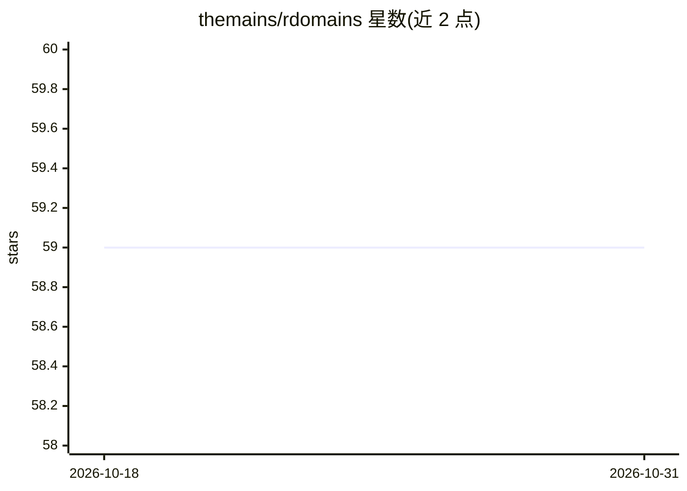

# themains/rdomains

⭐ 59 · R · NOASSERTION · 推送 2026-10-30 · [GitHub](https://github.com/themains/rdomains) · [官网](http://themains.github.io/rdomains/) · 个人维护

**R 包：基于内容的域名分类，支持 LLM 与 ML 模型**

R 语言包，提供多种按内容对域名分类的途径：调用 OpenAI GPT 模型或 Anthropic Claude 模型获取分类、VirusTotal API、基于 Shallalist 数据训练的机器学习模型，以及 DMOZ、Steven Black、大学域名列表等静态数据源。README 明确说明 Shallalist/DMOZ 已停止发布（归档数据），并提醒标签有年代性，域名过期重注册后旧标签可能不再适用，函数会返回 source_last_published 列并告警。通过 CRAN 或 GitHub 安装，MIT 许可。

## 筛选速览

| 维度 | 判定 | 备注 |
|---|---|---|
| AI 角色 | `ai-native` | 本体是模型或模型工具 |
| 许可风险 | `none` | NOASSERTION |
| 部署形态 | `None` |  |
| 模型依赖 | locked-api |  |
| 硬件要求 | — | 无带数字的原话,不猜 |
| 安装摩擦 | `low` | 无编译、无系统依赖或容器化 |
| 成熟度 | — | 结构信号不足 |

## 能力要点

- 支持 OpenAI GPT 与 Anthropic Claude 模型对域名分类
- 提供基于 Shallalist 数据训练的机器学习模型
- 多个静态数据源（DMOZ/Steven Black/大学域名列表）
- 返回标签的 source_last_published 与状态，提示标签时效性

## 适用场景

- 按内容对域名批量分类打标
- 用 LLM 或 ML 模型判断网站类别
- 获取带发布时间标注的域名历史类别证据

## 场景标签

 · 领域:Web 内容分类/机器学习

## 证据(README 行号)

> L1: ## rdomains: Classify Domains Based on Their Content
> L6: The package provides several ways to classify domains based on their content. You can get categorizations from Shall

## 星数曲线

2026-10-18 59 → 2026-10-31 59（+0）

---
*卡片 v1 · prompt 1.4 · 生成 2026-10-24 · 置信度 high · 依据 README sha `0bef5b0642c2` · [字段定义](../../DATASET.md)*
