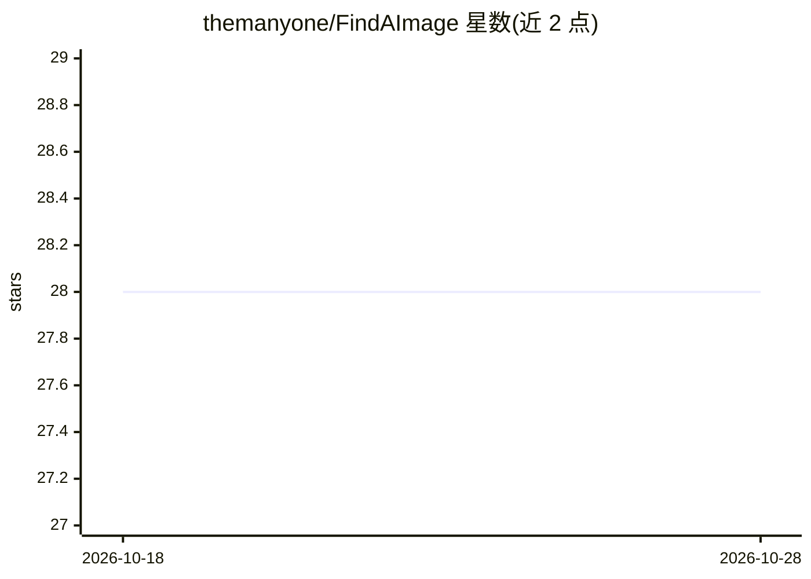

# themanyone/FindAImage

⭐ 28 · Python · GPL-2.0 · 推送 2026-10-03 · [GitHub](https://github.com/themanyone/FindAImage) · 个人维护

**为照片/表情包文件夹生成可搜索的 AI 描述与多模态聊天应用**

在浏览器中为图片与音频生成可搜索的 AI 描述，构建照片相册、表情包页面与在线作品集；支持手动编辑描述并可保存为可发布网页。默认推荐本地 llama.cpp/llama-server 运行 LLAVA、Ultravox、Omni 等 GGUF 模型保持离线私有，也可选接 OpenAI ChatGPT 或 Google Gemini。附带 aichat.py 多模态聊天服务器，支持文本/图片/音频同时输入、文档上传、投票排序与画布编辑。生成限制 token 数（默认 200）以控制发热，需自建本地模型服务器。

## 筛选速览

| 维度 | 判定 | 备注 |
|---|---|---|
| AI 角色 | `ai-native` | 本体是模型或模型工具 |
| 许可风险 | `viral` | GPL-2.0 |
| 部署形态 | `library` | 以包/库形式分发 |
| 模型依赖 | local-ok | 支持本地模型 |
| 硬件要求 | `gpu-8g` | |
| 安装摩擦 | `medium` | 含编译或系统依赖之一 |
| 成熟度 | — | 结构信号不足 |

## 能力要点

- 为图片与音频生成 AI 描述并可手动编辑，导出可搜索的相册网页
- aichat.py 多模态聊天服务器，支持文本/图片/音频同时输入
- 通过 llama.cpp 本地运行 LLAVA/Ultravox/Omni 等 GGUF 模型
- 可选接入 OpenAI ChatGPT 与 Google Gemini API

## 适用场景

- 给表情包/照片文件夹批量生成描述，做成可搜索的相册网页
- 本地离线对图片与音频做 AI 打标，保护隐私
- 搭建局域网多模态聊天界面，对模型投票排序

## 场景标签

`多模态` `语义搜索` · 领域:知识与检索

## 证据(README 行号)

> L3: Use manually-entered and AI-generated descriptions to build organized photo albums, multimedia portfolios, and meme 
> L17: * `aichat.py` server - supports multimodal text, image, and audio input.
> L109: This starts a chat server (yes, yet another server--a web server this time) so, if port 7860 is open on your firew

## 星数曲线

2026-10-18 28 → 2026-10-28 28（+0）

---
*卡片 v1 · prompt 1.4 · 生成 2026-10-26 · 置信度 mid · 依据 README sha `365554a4bbff` · [字段定义](../../DATASET.md)*
