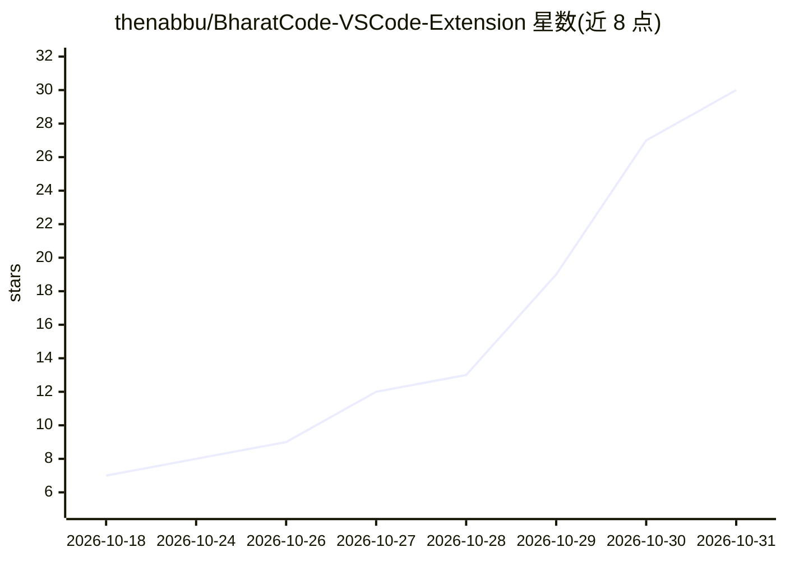

# thenabbu/BharatCode-VSCode-Extension

⭐ 30 · TypeScript · NOASSERTION · 推送 2026-10-30 · [GitHub](https://github.com/thenabbu/BharatCode-VSCode-Extension) · [官网](https://bharatcode.ai) · 个人维护

**面向 bharatcode.ai 的开源 VS Code AI 编程助手扩展**

Kilo Code（v7.8.8）的 fork，重新配置为接入 bharatcode.ai 提供商。以 VSIX 扩展形式运行于 VS Code，内置后端二进制在本地以仅监听 127.0.0.1 的懒启动服务器方式运行，通过单一 API key 经 BharatCode API 调用两款模型（qwen-3.8-27b，262k 上下文；deepseek-v4.1-flash，1M 上下文），支持任务中途切换。提供 Code/Plan/Ask/Debug 四种内置 agent 与自定义 agent、多文件代码生成、行内补全（需自带 key 的提供商）、终端与浏览器控制、Agent Manager 多 agent 会话（各会话隔离于独立 git worktree）。API key 存储于扩展后端而非 settings.json。

## 筛选速览

| 维度 | 判定 | 备注 |
|---|---|---|
| AI 角色 | `ai-native` | 本体是模型或模型工具 |
| 许可风险 | `none` | NOASSERTION |
| 部署形态 | `desktop` | 安装包/桌面程序 |
| 模型依赖 | — | README 未给出锁定关系 |
| 硬件要求 | — | 无带数字的原话,不猜 |
| 安装摩擦 | `low` | 无编译、无系统依赖或容器化 |
| 成熟度 | — | 结构信号不足 |

## 能力要点

- 两款模型（qwen-3.8-27b 262k / deepseek-v4.1-flash 1M）经单一 OpenAI 兼容端点调用，支持任务中切换
- 扩展自带后端二进制，懒启动本地服务器，仅监听 127.0.0.1 并以随机密码保护
- Code/Plan/Ask/Debug 四种内置 agent，可自定义
- Agent Manager 多 agent 会话，各会话隔离于独立 git worktree

## 适用场景

- 在 VS Code 内通过自然语言让 AI 实现和编辑多文件代码
- 让 agent 制定架构与实现计划后再编码
- 运行命令与自动化网页操作、排查调试问题

## 场景标签

`编码 Agent` `多智能体` `浏览器自动化` · 领域:Agent 开发

## 证据(README 行号)

> L5:  The open source AI coding agent for VS Code, powered by bharatcode.ai.
> L13: > **Fork notice:** BharatCode is a fork of Kilo Code (itself a fork of OpenCode), rebranded and reconfigured for th

## 星数曲线

2026-10-18 7 → 2026-10-31 30（+23）

---
*卡片 v1 · prompt 1.4 · 生成 2026-10-28 · 置信度 high · 依据 README sha `fbed2eac273b` · [字段定义](../../DATASET.md)*
