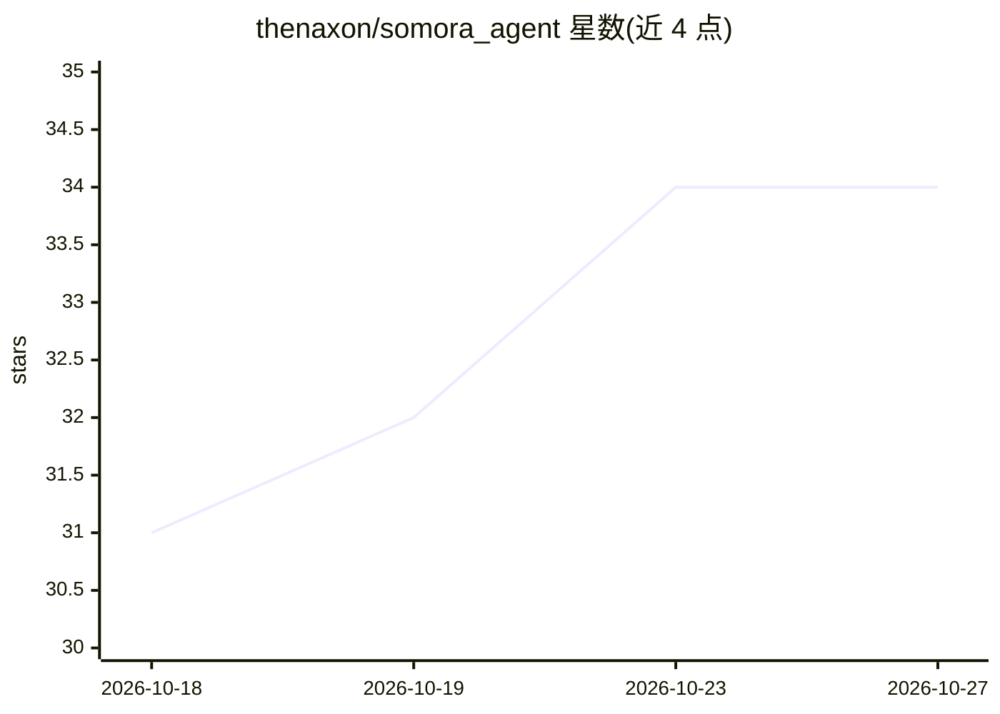

# thenaxon/somora_agent

⭐ 34 · TypeScript · MIT · 推送 2026-10-17 · [GitHub](https://github.com/thenaxon/somora_agent) · [官网](https://somora.ai) · 个人维护

**本地优先的个人 AI agent 团队：多 agent 共享记忆、任意模型**

在本机运行一个小型服务器托管个人 agent 团队，通过终端、浏览器或手机对话。支持在对话中切换 Claude/ChatGPT/Grok 及任意 OpenAI 兼容端点（Ollama、LM Studio、vLLM、OpenRouter）。agent 分 chat agent 与 builder 两类，具备共享长期记忆并沉淀为 Obsidian 共享 wiki 的 dream 周期，可选技能、媒体生成、共享浏览器、语音通话、MCP 服务器、外部 agent（A2A/ACP）等。要求 Node ≥22.22.2、macOS 或 glibc ≥2.34 的 Linux、tmux 及至少一个 LLM 后端。

## 筛选速览

| 维度 | 判定 | 备注 |
|---|---|---|
| AI 角色 | `ai-ecosystem` | LLM/agent 周边工具 |
| 许可风险 | `permissive` | MIT |
| 部署形态 | `None` |  |
| 模型依赖 | local-ok | 支持本地模型 |
| 硬件要求 | — | 无带数字的原话,不猜 |
| 安装摩擦 | `medium` | 含编译或系统依赖之一 |
| 成熟度 | `idea` | |

## 能力要点

- 多 agent 团队与 team.yaml 汇报关系，agent 间可委托与生成子 agent
- 对话中用斜杠命令切换 Claude/ChatGPT/Grok/本地模型，历史与工具保留
- 共享长期记忆经 dream 周期沉淀为 Obsidian 共享 wiki
- 支持外部 MCP 服务器、外部 agent（A2A/ACP）、共享 Chromium 浏览器与语音通话

## 适用场景

- 在本机搭建可跨设备访问的个人 AI agent 团队
- 用 builder agent 在代码仓库中规划、编辑、运行、测试
- 让 agent 通过计划触发器（cron/daily）自动值守任务

## 场景标签

`多智能体` `Agent 记忆` `编码 Agent` · 领域:Agent 开发

## 证据(README 行号)

> L77: A small server you run on your machine that hosts your agents. You chat
> L81: attachments, sub-agents — regardless of which LLM you point them at.
> L141: - **External MCP servers** — one config entry, all engines see the tools,

## 星数曲线

2026-10-18 31 → 2026-10-27 34（+3）

---
*卡片 v1 · prompt 1.4 · 生成 2026-10-25 · 置信度 high · 依据 README sha `ca52fa27dddb` · [字段定义](../../DATASET.md)*
