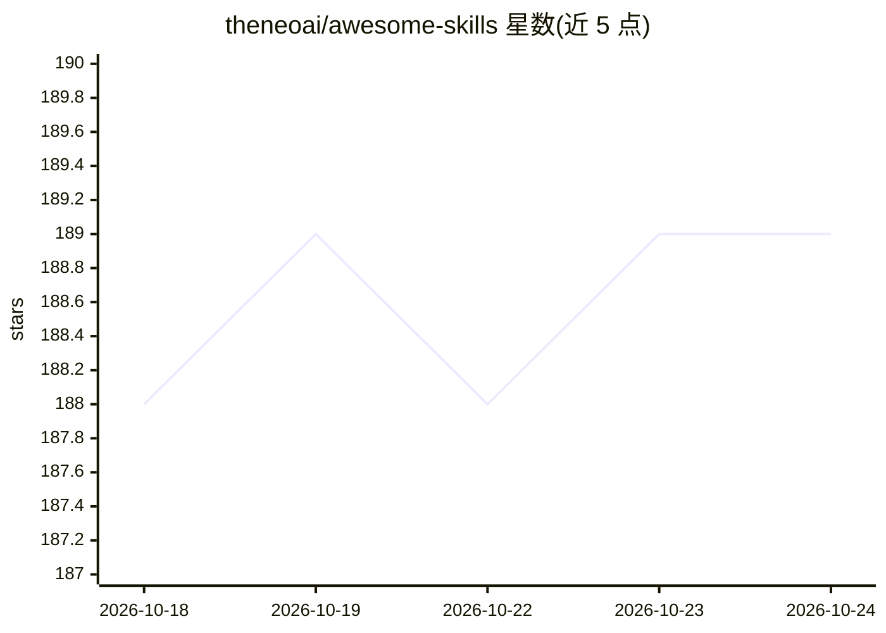

# theneoai/awesome-skills

⭐ 189 · JavaScript · NOASSERTION · 推送 2026-05-15 · [GitHub](https://github.com/theneoai/awesome-skills) · [官网](https://theneoai.github.io/awesome-skills) · 组织维护 · 中文 README

**按专业领域组织的 956 个 AI 角色技能库（persona/tool/workflow）**

收录 956 个 SKILL.md 格式技能文件（827 个为 persona），覆盖 60+ 专业领域，每个技能是角色化提示词包（系统指令+参考资料），用于在 Claude Code、OpenCode、Cursor 等 agent 运行时中给 LLM 加载专业身份或工作流方法论。明确声明非可执行插件、质量分为自评。另含 Python 分析工具（8 维评分/Token 预算/反模式扫描）、CI 质量门禁与第三方 skill 仓库注册表。提供双语 README 与各平台安装指南。

## 筛选速览

| 维度 | 判定 | 备注 |
|---|---|---|
| AI 角色 | `ai-knowledge` | 知识聚合/清单类 |
| 许可风险 | `none` | NOASSERTION |
| 部署形态 | `library` | 以包/库形式分发 |
| 模型依赖 | — | README 未给出锁定关系 |
| 硬件要求 | — | 无带数字的原话,不猜 |
| 安装摩擦 | `medium` | 含编译或系统依赖之一 |
| 成熟度 | — | 结构信号不足 |

## 能力要点

- 956 个技能文件，persona/tool/workflow 三类，覆盖 60+ 领域
- Python 分析工具：8 维评分、Token 成本、反模式扫描，CI 阻塞低分合并
- external/ 注册表按需浅拉取第三方 skill/subagent 仓库
- 100+ 仿照特定公司方法论建模的企业角色技能

## 适用场景

- 为我的 agent 运行时挑选特定职业的专业 persona
- 研究各公司工程方法论如何被建模为提示词
- 用附带的评分工具分析自己写的 SKILL.md

## 场景标签

`提示工程` `精选清单` · 领域:Agent 开发

## 证据(README 行号)

> L19: A library of **956 skill files** (`SKILL.md` + optional `references/`) covering 3 kinds (persona / tool / workflow)
> L131: 按专业领域组织的 **AI Skill 库**，共 **956 个技能**，按 3 种类型（persona / tool / workflow）覆盖 60+ 领域。每个技能是一份 `SKILL.md`（+ 可选 `referen

## 星数曲线

2026-10-18 188 → 2026-10-24 189（+1）

---
*卡片 v1 · prompt 1.4 · 生成 2026-10-22 · 置信度 high · 依据 README sha `307c10e8548d` · [字段定义](../../DATASET.md)*
